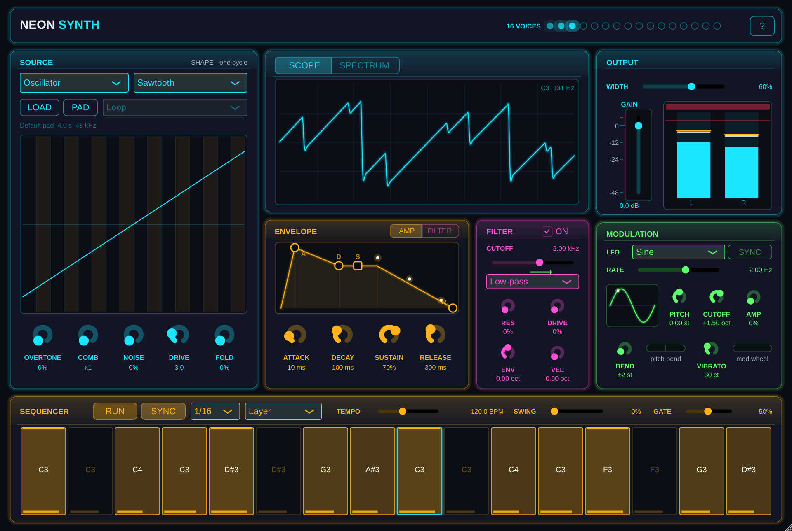

# Neon Synth

[](https://github.com/kv244/NeonSynth/actions/workflows/test.yml)
[](https://github.com/kv244/NeonSynth/actions/workflows/build.yml)
[](https://github.com/kv244/NeonSynth/actions/workflows/lint.yml)
[](https://github.com/kv244/NeonSynth/actions/workflows/release.yml)
[](https://github.com/kv244/NeonSynth/releases/latest)

A virtual analog synthesizer with the look of an old phosphor monitor, built with JUCE and C++20,
by **Razvan Julian Petrescu** / **AudioDSP**.

NeonSynth is a learning synthesizer for musicians and coders: every control shows what it does to the sound,
and the **[user manual](docs/NeonSynth-User-Manual.md)** teaches it by ear and maps it to the C++ source.



**[If you want to hear it in action](https://github.com/kv244/NeonSynth/releases/download/demo/neonsynth-demo.wav)**: a 42-second piece (WAV, 8 MB) in which every
sound is NeonSynth, the drums included. Nine instances play together: a kick, snare and crash made by
sweeping a note down with GLIDE, a granular pad breathing with the LFO, a Random-source bass through
CHOP and the wavefolder, a 303-style acid line from the step sequencer (one voice, slides, ties and accents into a
resonant, driven filter, latched with HOLD), noise hats through the high-pass filter, a chopped sawtooth arpeggio
through a resonant band-pass, and a looped-sample lead played MONO with LEGATO and GLIDE, the mod wheel's vibrato
and a final pitch bend. [`docs/demo/make_demo.py`](docs/demo/make_demo.py) renders it from the VST3.

**[Watch it played live](https://youtu.be/wh0MDSjokBQ)**: a video of the author playing NeonSynth with an Arturia MiniLab 3 keyboard.

## Highlights

- **Four sound sources**: a band-limited oscillator (sine, square, triangle, sawtooth), your own sample,
  a granular cloud of that sample, and Random, a pitched wave of 16 drifting steps.
- **Waveform sculpting**: CHOP cuts or flips steps of every cycle (after the Roland S-1), NOISE fades the
  wave into white noise, and FOLD folds it back on itself.
- **Fourier**: build a wave from up to 32 harmonics (and hear it BUILD one harmonic at a time), draw one
  cycle and hear its harmonics, and switch band-limiting off (NAIVE) to hear and see aliasing.
- **Envelope, filter and output**: an ADSR you can drag on its own graph; a state-variable filter with four
  modes, resonance up to self-oscillation, drive, its own envelope and velocity; up to 16 voices panned by
  pitch (click the voice lights for fewer, down to mono), and a soft clipper that keeps the output under −1 dBFS.
- **Movement**: one LFO (sine, triangle, square, saw, random; free or synced to the tempo, with bars that
  follow the DAW's time signature) on pitch, cutoff and level; pitch bend with a range of up to 24 semitones;
  and a mod-wheel vibrato, all from MIDI.
- **Playing**: HOLD keeps your keys sounding (and latches the key in Transpose mode), GLIDE slides each voice
  to its next note in every source, and LEGATO joins overlapping keys in mono without a new attack.
- **16-step sequencer**: sample-accurate, synced to the DAW or its own tempo, with swing, gate and three
  keyboard modes; a LENGTH of 1 to 16 steps, TIE and SLD (303-style slides) on every step, velocity as the
  accent, a KEY and SCALE lock with 13 scales, ENTER to fill steps from your keyboard, pattern TOOLS
  (shift, octave, reverse, randomise in the scale, clear) and 32 levels of UNDO.
- **Presets**: a preset bar with 24 factory presets in seven categories (also the DAW's program list), and
  SAVE for your own, as `.neonpreset` files you can send to someone.
- **You see what you hear**: oscilloscope, spectrum with the filter curve (and NAIVE's folded harmonics in red), the harmonics as bars, envelope with a dot per voice,
  the LFO's shape and position, the bend and mod-wheel positions, voice lights and a stereo meter, in a window that scales from 75% to 150%. It looks like an old
  phosphor monitor: glowing traces with a short afterglow, a bezel, and scanlines you can switch off.
- **Sessions keep everything**: the sample, the sequencer pattern, the CHOP pattern and a custom wave are saved with the
  DAW project, along with the preset it came from, and every parameter can be automated.

## How the sound is made


The **[user manual](docs/NeonSynth-User-Manual.md)** explains every control, with listening exercises,
sound-design starting points, troubleshooting and a tour of the C++ source. Each release also carries it
as a PDF.

For the theory behind it, two companion books live in [`docs/theory`](docs/theory):
**[The DSP Behind NeonSynth](docs/theory/DSP-Behind-NeonSynth.md)**, a short textbook for musicians and
programmers that connects each control to its mathematics, its code and its tests, with eighteen listening
laboratories; and the **[Mathematical Compendium](docs/theory/Mathematical-Compendium.tex)** (LaTeX,
[PDF](docs/theory/Mathematical-Compendium-v1.12.0.pdf)), the derivations: band-limited edges, the
zero-delay-feedback filter and its self-oscillation limiter, anti-aliased drive, granular synthesis,
resampling, modulation, glide and the sequencer's clock, Fourier series and wavetables. Both are checked against the release they name, like the manual; an edition holds for every patch release of its version (the v1.12.0 editions hold for every v1.12.x).

## Installation

Windows 10 or 11, 64-bit. Download `NeonSynth-x.y.z-Windows-Setup.exe` from the
**[latest release](https://github.com/kv244/NeonSynth/releases/latest)** and run it.

| Installed | Where |
|---|---|
| VST3 instrument | `C:\Program Files\Common Files\VST3\NeonSynth.vst3` |
| Standalone application (optional) | `C:\Program Files\AudioDSP\Neon Synth\NeonSynth.exe` |
| User manual as a PDF (optional) | `C:\Program Files\AudioDSP\Neon Synth\NeonSynth-User-Manual-x.y.z.pdf`, with a Start menu shortcut |

In a DAW, rescan your VST3 plugins and look for **NeonSynth** under the manufacturer **AudioDSP**. In the
Standalone, choose your audio output and MIDI input under **Options → Audio/MIDI Settings**; with no MIDI
keyboard, press **RUN** and the sequencer plays. The installer is not code-signed yet, so Windows SmartScreen
may ask you to confirm. The manual's first chapters cover setup in detail.

## Building

You need CMake 3.22 or newer, a C++20 compiler (MSVC 2022, Clang 10 or GCC 10 or newer) and git.
[JUCE 9.0.0](https://github.com/juce-framework/JUCE/releases/tag/9.0.0) comes by itself: the first
configure downloads it (CMake's FetchContent, pinned to the 9.0.0 commit) into the build folder.

```bash
cmake -S . -B build -DCMAKE_BUILD_TYPE=Release
cmake --build build --config Release
```

To build against a JUCE checkout you already have (offline, or shared between builds), add
`-DJUCE_DIR="/path/to/JUCE"`; a checkout in `./JUCE` is picked up without it.

The VST3 and the Standalone land in `build/NeonSynth_artefacts/Release/`. The
**[developer notes](docs/DEVELOPMENT.md)** cover the unit tests, the Python test suite, the benchmark,
MIDI logging and the layout of the source.

## Contributing and security

- **[Contributing](CONTRIBUTING.md)**: how to build and test a change, the real-time rules, and what a
  pull request must keep (old sessions sound the same, new parameters go last, every feature shows in
  the window).
- **[Architecture](docs/DEVELOPMENT.md#architecture)**: the signal path and which thread does what.
- **[Security](SECURITY.md)**: how to report a file that crashes or hangs the plugin, privately.
- **[Changelog](CHANGELOG.md)**: every release.

## Recent releases

| Version | Date | What changed |
|---|---|---|
| [v1.12.0](https://github.com/kv244/NeonSynth/releases/tag/v1.12.0) | 24 Nov 2026 | "Fourier": NAIVE to hear aliasing, CUSTOM waves of up to 32 harmonics in a new HARMONICS view with BUILD and ZERO PHASE, and DRAW to draw one cycle; eight new factory presets that use them; two granular fixes; C++20 and faster builds |
| [v1.11.1](https://github.com/kv244/NeonSynth/releases/tag/v1.11.1) | 23 Nov 2026 | Refactor release: controls, window and sound unchanged, except that a granular grain bent up past the end of its sample now ends there whatever the block size. The manual's licence and warranty text follows AGPL-3.0-only. JUCE is fetched by CMake when no JUCE_DIR is given; the processor is split by job into smaller files, and a cold build of the plugin and its tests is about five times faster (32 min to 6 min on 2 cores); Python dependencies are pinned with hashes and updated by Dependabot |
| [v1.11.0](https://github.com/kv244/NeonSynth/releases/tag/v1.11.0) | 23 Nov 2026 | "Playing": HOLD, GLIDE and LEGATO; the sequencer gains LENGTH, TIE and SLD (303-style slides), a KEY and SCALE lock, ENTER from the keyboard, pattern TOOLS, 32-level UNDO and a draggable velocity bar as the accent; presets, with a preset bar, SAVE and 16 factory presets that are also the DAW's program list; LFO bars follow the time signature. Fixes: two voice-stealing faults below 16 voices (sessions using fewer voices may differ where a note is stolen) and a one-sample drift of the internal clock. New tests for playing, presets, voice stealing and sample-rate and block-size sweeps, and the integrity job |
| [v1.10.1](https://github.com/kv244/NeonSynth/releases/tag/v1.10.1) | 18 Nov 2026 | Hardening: a damaged or hostile session can no longer crash or hang the plugin (a bad embedded-sample size, parameter values that are not numbers, XML nested hundreds of thousands deep, a relative sample path); the host hears of a background sample load on the message thread; new tests for broken sessions, sessions saved by v1.2 to v1.10, random sequencer and envelope settings, and an ASan/UBSan CI job; SECURITY, CONTRIBUTING and this changelog. No change to controls or sound |

Every release is in the **[changelog](CHANGELOG.md)**, linked to its GitHub release with the installer
(and, from v1.6.0, the manual as a PDF).

## JUCE or Qt for the GUI

JUCE and Qt are both C++ frameworks that can draw a window, but they are built for different jobs. JUCE is an
audio framework that includes a GUI; Qt is a general application framework with no audio-plugin support.
NeonSynth uses JUCE. This section says when each one is the right choice and why NeonSynth chose as it did.
It compares JUCE 9.0.0, which NeonSynth builds with, and Qt 6.12, the current Qt release in November 2026.

### When JUCE is the right choice

- **Audio plugins** (VST3, AU, AAX, LV2) whose window opens inside a DAW. The host embeds the editor, and JUCE
  is designed for exactly that.
- **Standalone audio programs** where the sound engine and the window are one codebase: synths, effects,
  tuners, small recorders.
- **Custom-drawn, single-window interfaces**: knobs, meters, scopes, waveforms. JUCE gives a canvas and a few
  audio-minded controls and expects you to draw the rest.
- **Controls that must be automatable.** JUCE ties a knob to a plugin parameter, including the begin and end
  of a drag that a DAW records.
- **One dependency, one file to ship.** JUCE compiles into the binary; there is nothing else to install.

### When Qt is the right choice

- **General desktop applications** with many standard parts: forms, tables, trees, docking panels, menus,
  several windows, rich text. Qt's widget set is large and mature; JUCE's is small.
- **Data-heavy interfaces**: lists and tables backed by models, databases, file browsers.
- **Designer-led or declarative interfaces.** QML, Qt Designer and Qt Design Studio let a designer build and
  animate the UI; JUCE's UI is C++ code.
- **Touch screens and embedded devices**: instrument panels, kiosks, the screen of a hardware unit.
- **Wide reach**: strong accessibility, translation tooling, right-to-left text and input methods.
- **Programs where audio is one feature among many.** Qt handles the application, and a separate audio
  library handles the sound.

### Where they overlap

A standalone audio application can go either way. Large ones with many windows and lists (a DAW, a sample
librarian) lean to Qt with a separate audio engine; instrument-like ones lean to JUCE. A plugin window in Qt
is possible but uncommon: Qt expects to own the application object and the event loop, a plugin is a guest in
the host's process, and the bridge between the two is yours to write and maintain.

### The decision for NeonSynth: JUCE

1. **It is a plugin first.** NeonSynth ships as a VST3 with a Standalone beside it. JUCE provides the plugin
   format, the audio thread and the window from one codebase, and the window behaves correctly inside a host.
2. **Every control is a parameter.** Knobs, switches and choices are attached to automatable parameters;
   the editor tests check that each drag reaches the host as one gesture.
3. **The interface is drawn by hand.** The scope, spectrum, envelope, sample view and step grid are all custom
   paint code. Qt's main advantage, its ready-made widgets, would go unused.
4. **It ships as one file.** JUCE is compiled in, so the installer copies a `.vst3` and an `.exe` and nothing
   else. Qt would add its libraries next to the plugin, in a folder shared with other plugins.
5. **The licence matches.** JUCE is available under AGPLv3, which is NeonSynth's own licence.

What this costs: no visual designer, no layout managers beyond FlexBox and Grid (NeonSynth lays everything out
on a fixed 1280 x 860 grid and scales it), and thinner accessibility than Qt offers. Qt would be the better
choice for a standalone companion tool built from standard widgets, such as a preset librarian.

### At a glance

| | JUCE 9 GUI | Qt 6 |
|---|---|---|
| Made for | Audio plugins and audio programs | General applications, desktop to embedded |
| Window inside a DAW | Built in | Not designed for it |
| Automatable parameters | Built in (attachments) | You write the binding |
| Ready-made widgets | Few, audio-minded | Many, mature |
| Design tools | None; C++ (or HTML in a WebView) | QML, Qt Designer, Qt Design Studio |
| Rendering | Own 2D renderer (Direct2D, CoreGraphics, software; OpenGL optional) | Software for Widgets; GPU for Qt Quick |
| Shipping | Compiled in, one file | Libraries shipped alongside |
| Licence | AGPLv3 or commercial | LGPLv3 for most modules, GPLv3 for some, or commercial |

Sources: [JUCE 9 announcement](https://forum.juce.com/t/juce-9-is-available-now/69175), JUCE 9.0.0's
`CHANGE_LIST.md` and `LICENSE.md`, [Qt licensing](https://doc.qt.io/qt-6/licensing.html). Licence terms change;
check the linked pages before relying on them.

## License

Copyright (C) 2026 Razvan Julian Petrescu. Portions assisted by Claude (Anthropic).

NeonSynth is free software: you can redistribute it and/or modify it under the terms of the
[GNU Affero General Public License version 3](LICENSE) (AGPL-3.0-only), as published by the Free
Software Foundation. It is distributed in the hope that it will be useful, but WITHOUT ANY
WARRANTY; without even the implied warranty of MERCHANTABILITY or FITNESS FOR A PARTICULAR PURPOSE.
See the license for details.

NeonSynth is built on [JUCE](https://juce.com), which it uses under JUCE's AGPLv3 option. If you
distribute NeonSynth, or software built from it, you must make the complete corresponding source
available under the same license; this repository is that source for the official releases.

Releases up to and including v1.3.0 were published under the MIT license; from v1.4.0 the project
is licensed under the AGPLv3.

The two fonts compiled into the plugin since v1.10.0 are under the SIL Open Font License 1.1:
[VT323](https://github.com/google/fonts/tree/main/ofl/vt323) by Peter Hull
([`fonts/OFL-VT323.txt`](fonts/OFL-VT323.txt)) and
[IBM Plex Mono](https://github.com/IBM/plex) by IBM ([`fonts/OFL-IBMPlexMono.txt`](fonts/OFL-IBMPlexMono.txt)).
The installer copies both licences next to the plugin.
