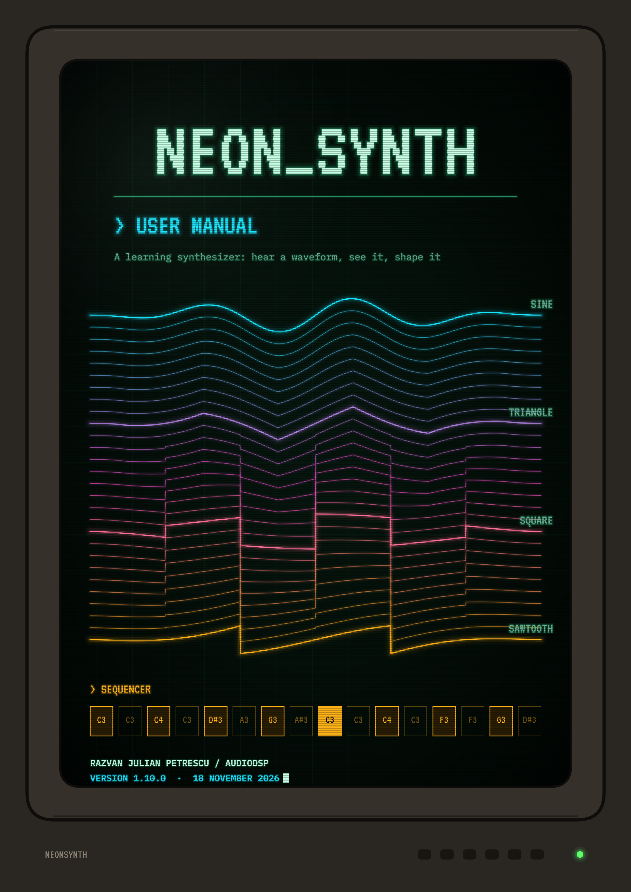
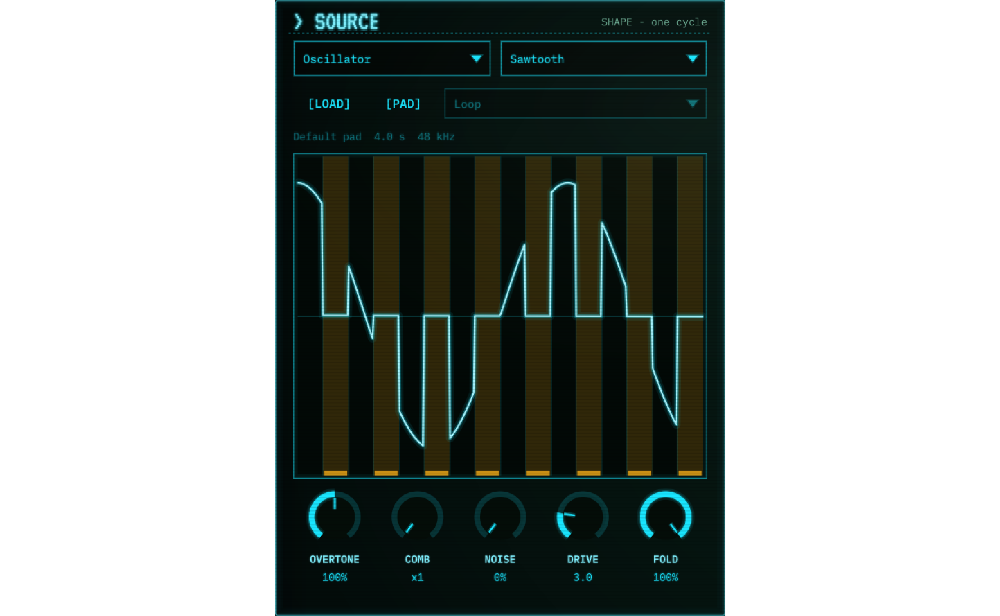

<!-- github-cover: shown on GitHub only; the PDF build draws its own full-page cover and drops this block -->
<p align="center"></p>
<!-- /github-cover -->

# NeonSynth User Manual

NeonSynth is a learning synthesizer: a place to hear what a waveform sounds like, see what changes when you shape it, and explore the code that makes it happen. Its oscillator, sample, random, and granular engines provide different starting points for that exploration, with source code available to read, build, and modify ([NeonSynth project](https://github.com/kv244/NeonSynth)).

For musicians, begin with one note and one waveform, without stacked oscillator layers obscuring what you are hearing. For coders, follow the same sound into the C++ implementation, from waveform generation through envelope, filter, and output; the interface and the code become two views of the same instrument ([voice architecture](https://github.com/kv244/NeonSynth/blob/v1.12.0/src/plugin/NeonSynthVoice.h)).

**Instrument:** NeonSynth by Razvan Julian Petrescu / AudioDSP  
**Edition:** 3.0, updated 27 November 2026 (v1.12.0 "Fourier": NAIVE, CUSTOM with the HARMONICS view and BUILD, and drawing one cycle, in a new chapter; edition 2.0 covered v1.11.0 "Playing", 2.1 v1.11.1)<br>
**Applies to:** NeonSynth v1.12.0, source tag `v1.12.0`  
**Formats:** VST3 instrument and standalone application; a Windows installer is supplied for this release ([v1.12.0 release](https://github.com/kv244/NeonSynth/releases/tag/v1.12.0)).

### About this manual

The instructions were checked against the v1.12.0 source code. Every recipe in the sound-design chapter was rendered through the plugin, to confirm that it sounds, releases cleanly to silence and stays clear of the output soft clipper: the first six through v1.6.0, which v1.7.0 to v1.11.1 keep bit-identical at the settings they use (each version's new controls start neutral), as the project's compare test checks; the wind recipe through v1.9.0, which v1.10.0 to v1.11.1 keep bit-identical. The 16 factory presets of v1.11.0 are checked by the project's preset test: each one loads, renders below −6 dBFS, under the output soft clipper, and ends in silence. This is not a certification of compatibility with every audio device or DAW.

Each figure is labelled by how it was made: **Actual application capture** (a screenshot of the running instrument, with numbered callouts added), **Plot derived from rendered audio** (measured from sound the plugin produced, with the settings stated), or **Explanatory schematic** (a drawing that explains an idea and is not a measurement). How to regenerate them is in [figures/README.md](figures/README.md).

The sound-design settings are starting points to set by hand; most of them are also in the factory bank (see [Presets](#presets)). Begin at a low listening level and adjust by ear.

## What's new in this version

Each release adds its entry at the top of this section; the full history, fixes and internal changes included, is in the [CHANGELOG](https://github.com/kv244/NeonSynth/blob/master/CHANGELOG.md).

### v1.12.0 "Fourier"

- **A new chapter, [Fourier: hearing the harmonics](#fourier-hearing-the-harmonics),** with three new switches above the SHAPE strip, for the Oscillator source:
  - **NAIVE** switches band-limiting off, so you hear aliasing; the SPECTRUM marks in red where the folded harmonics land.
  - **CUSTOM** plays a wave built from up to 32 harmonics, which you set as bars in the new **HARMONICS** view. Presets give the textbook waves, **BUILD** adds the harmonics one at a time, and **ZERO PHASE** shows that the ear ignores phase. **HARMONICS** sets how many play and can be automated.
  - **DRAW** lets you draw one cycle in the SHAPE strip; it plays as its first 32 harmonics, clean at any pitch.
- **Granular:** a grain whose pitch JITTER raises it past a band-limit now reads the next band-limited copy of the sample, so it no longer aliases; SIZE and DENSITY glide over 20 ms when you turn or automate them, instead of stepping the level. Sessions that never move them during a note, or use no JITTER, sound as before.
- **Eight new factory presets** (programs 16 to 23) show the new switches: Drawbar Organ, Square Ladder, Octave Stack, Hollow Reed, Phase Matters, Aliased Arcade, Vowel Ah and Fold-back Siren. See [The factory bank](#the-factory-bank).
- **Everything else sounds as it did:** with the three switches off, sessions from earlier versions render identically.
- **For builders:** the code is now C++20, and rebuilds after an edit are two to three times faster (precompiled JUCE headers, the mold linker). See [Building from source](#building-from-source).

### v1.11.1

- **Nothing you hear or see changes,** with one exception: on the Granular source, a grain whose pitch is raised while it plays (pitch bend, vibrato, the LFO on pitch, or a glide up) so far that it would read past the end of the sample now ends there. Before, how it ended depended on the audio block size, so the same session could sound slightly different in two DAWs. Only notes bent up near the very end of a sample are affected. See [Pitch bend and mod wheel](#pitch-bend-and-mod-wheel).
- **Licence and warranty:** the fine print at the end of this manual now follows the AGPL-3.0-only licence the project uses, including its own no-warranty terms.
- **For builders:** CMake now downloads JUCE by itself when you do not point it at a copy, and the plugin and its tests build about five times faster. See [Building from source](#building-from-source).

### v1.11.0 "Playing"

- **HOLD** keeps keyboard notes sounding after you let go, until you switch it off; in Transpose mode it latches the key, so the pattern plays on. See [Playing: HOLD, GLIDE and LEGATO](#playing-hold-glide-and-legato).
- **GLIDE** slides each new note from the last one in a set time, and **LEGATO**, with one voice, makes overlapping keys glide without a new attack.
- **The step sequencer** gains a pattern LENGTH of 1 to 16 steps, TIE and SLD (slide) on each step, a KEY and SCALE lock, note entry from the keyboard (ENTER), pattern TOOLS, and UNDO. The velocity bar of each step can be dragged: velocity is the accent. See [Step sequencer](#step-sequencer).
- **Presets:** a preset bar in the header, your own presets in Documents/NeonSynth/Presets, and 16 factory presets, which are also the DAW's program list. See [Presets](#presets).
- **Changed:** a synced LFO set in bars follows the DAW's time signature (in 3/4 a bar is three beats), so such a session in a project that is not in 4/4 sounds different from v1.10. With fewer than 16 voices, the voice taken when all are busy is now the right one (a note held by the sustain pedal is no longer taken first).
- **Fixed:** Esc closes the help page in DAWs that keep the key to themselves; the internal clock no longer drifts by a sample with very small audio blocks.
- **The window:** the header, the MODULATION panel and the sequencer gained controls (Figures 1 and 8 show the v1.11.0 window); every other panel is where it was.

Earlier versions: [CHANGELOG](https://github.com/kv244/NeonSynth/blob/master/CHANGELOG.md).

## Contents

- [What's new in this version](#whats-new-in-this-version)
- [Getting started](#getting-started)
- [Learning by listening](#learning-by-listening)
- [Finding your way around](#finding-your-way-around)
- [Choosing a sound source](#choosing-a-sound-source)
- [Sculpting a waveform](#sculpting-a-waveform)
- [Fourier: hearing the harmonics](#fourier-hearing-the-harmonics)
- [Shaping a sound](#shaping-a-sound)
- [Movement: LFO, pitch bend and mod wheel](#movement-lfo-pitch-bend-and-mod-wheel)
- [Playing: HOLD, GLIDE and LEGATO](#playing-hold-glide-and-legato)
- [Sample playback](#sample-playback)
- [Granular synthesis](#granular-synthesis)
- [Step sequencer](#step-sequencer)
- [Output and visual feedback](#output-and-visual-feedback)
- [Presets](#presets)
- [Saving, automation, and MIDI](#saving-automation-and-midi)
- [Sound-design starting points](#sound-design-starting-points)
- [Troubleshooting](#troubleshooting)
- [Learning through the source code](#learning-through-the-source-code)
- [Technical reference](#technical-reference)

## Getting started

### Install the Windows release

Download `NeonSynth-1.11.1-Windows-Setup.exe` from the [v1.11.1 release page](https://github.com/kv244/NeonSynth/releases/tag/v1.11.1). The installer provides the VST3 instrument and an optional standalone application (see [Installation](../README.md#installation) in the README).

| Component | Default location |
|---|---|
| VST3 instrument | `C:\Program Files\Common Files\VST3\NeonSynth.vst3` |
| Standalone application | `C:\Program Files\AudioDSP\Neon Synth\NeonSynth.exe` |
| This manual as a PDF (optional) | `C:\Program Files\AudioDSP\Neon Synth\NeonSynth-User-Manual-x.y.z.pdf`, with a Start menu shortcut |

These are the documented default installation locations; the standalone installation directory can be changed in the installer.

### Make your first sound without a MIDI keyboard

Use this sequence for an uncomplicated standalone check. The built-in sequencer generates the notes, so no external MIDI input is required.

1. Launch `NeonSynth.exe`.
2. Open **Options → Audio/MIDI Settings**.
3. Select your audio output device and enable its output channels.
4. Set **Source** to **Oscillator** and **Waveform** to **Sawtooth**.
5. Leave **GAIN** at 0 dB and begin with your speakers or headphones turned down. A single note peaks around −12 dBFS, and the output soft clipper keeps even 16 loud voices below −1 dBFS, so set the listening level on your monitors rather than with GAIN.
6. Select sequencer mode **Layer**, turn **SYNC** off, and set **TEMPO** to approximately 120 BPM.
7. Press **RUN**.

The factory pattern should now provide a repeating starting point. **RUN** is off on a new instance, so the instrument is initially silent unless it receives MIDI notes; in standalone operation, the sequencer can use its own clock.

Once sound is present, move **Cutoff** to hear the brightness change, then try the other waveforms. Press **RUN** again to stop the pattern; notes already sounding are released rather than held indefinitely.

For a ready-made sound instead, click **>** in the preset bar at the top of the window: the factory presets in the Sequence category start the sequencer themselves (see [Presets](#presets)).

### Play from a MIDI controller

In standalone mode, enable the controller in **Options → Audio/MIDI Settings**, leave **RUN** off, and play the keyboard. In a DAW, load NeonSynth on an instrument/MIDI track, route the controller to that track, and enable the host's monitoring or record-arm function as required by the host. This has been tested with an Ableton Minilab 3 controller.

The main editor does not provide an on-screen piano keyboard. If you have no hardware controller, use the sequencer or route a virtual MIDI keyboard into the instrument.

### Use NeonSynth in a DAW

Rescan your DAW's VST3 instruments if NeonSynth does not appear after installation, then look for the **AudioDSP** manufacturer. With **SYNC** enabled, press **RUN** in NeonSynth and start the DAW transport to hear its sequence; the **HOST** tempo readout indicates that the host clock is being used.

NeonSynth is an instrument, not an effect for processing a live audio input. To use recorded audio as a sound source, load it into the Sample or Granular engine.

## Learning by listening

### One sound source per voice, not one note at a time

In Oscillator mode, each voice starts with one selected waveform, making it straightforward to compare shapes without a second oscillator or layered patch complicating the result. NeonSynth remains polyphonic: it can play up to 16 notes simultaneously; “one source per voice” does not mean “only one note at a time,” and the Granular engine builds its selected source from multiple grains.

The exercises below deliberately use one held note at first. Listen before looking at the display, then use Scope and Spectrum to connect what you hear with what you see.

### Listening exercise: meet the four waveforms

Use the following setup to minimise distractions. This is an educational comparison, not a factory preset or a loudness-calibrated test.

1. Turn **RUN** off and select **Source → Oscillator**.
2. Turn the **FILTER** off, set **WIDTH** to 0%, and leave **GAIN** at 0 dB, with your monitors turned down.
3. Set **ATTACK** to approximately 5 ms, **DECAY** to 100 ms, **SUSTAIN** to 100%, and **RELEASE** to 150 ms.
4. Hold a comfortable mid-range note, such as A4, using a similar playing velocity for each comparison.
5. Compare **Sine**, **Triangle**, **Square**, and **Sawtooth** without changing the note or envelope.
6. Repeat the comparison in **SCOPE**, then in **SPECTRUM**.

If one option sounds louder, lower the listening level rather than treating extra loudness as an improvement; focus on differences in character.

Ask yourself: which sounds smoothest, which feels hollow, and which has the most edge? These are listening prompts, not right-or-wrong labels; the point is to develop your own recognition of each shape.


Figure 2. The four waveforms at A4 (440 Hz). *Plot derived from rendered audio:* each row was rendered through the v1.7.0 plugin at 48 kHz with the settings of the exercise above (ATTACK 5 ms, DECAY 100 ms, SUSTAIN 100%, RELEASE 150 ms, filter off, WIDTH 0%, GAIN 0 dB, velocity 100). The waveform is the first 6.8 ms of the steady note; the spectrum is analysed from 1.0 to 1.5 s with a Blackman-Harris window. All rows share the same scales and none is normalised, so heights are directly comparable. Under each row the figure repeats the listening prompt.

### Listening exercise: hear what a filter removes

Keep the note and envelope unchanged, choose Sawtooth, then enable the filter and slowly move Cutoff down and back up. Switch to Sine and repeat the sweep, observing both the audible change and the spectrum display.

This isolates the relationship between the source and the filter: you are changing one stage while leaving the others alone. Bypass the filter periodically so your ear has an unfiltered reference.

Then return to Sawtooth, set the cutoff near 800 Hz and raise **RES** slowly. A narrow band around the cutoff grows louder until, near the top of the range, the filter whistles on its own: that whistle is a sine at the cutoff frequency, and it moves when you move Cutoff, not when you play another key.

### Listening exercise: separate tone from articulation

Keep one waveform and one cutoff setting, then compare a fast attack with a slow one; next compare short and long releases. Finally, lower Sustain and adjust Decay, listening to how the same source can behave like a pluck or a sustained instrument.

Only after those differences become familiar should you add chords, sequencing, and other source engines. This is a suggested learning order rather than a restriction on the instrument.

## Finding your way around


Figure 1. The main window (v1.12.0 at 150%, Source set to Oscillator, Sawtooth, with the sequencer running, and LFO CUTOFF at +1.5 octaves at 2 Hz, so the green band under CUTOFF and the dot in the LFO view show). *Actual application capture; the numbered outlines and the key below the picture were added.* Regions 1–14 are explained in the key, and the window is described panel by panel in the table below. Regions 11 to 14 are new in v1.11.0: 11, the preset bar in the header; 12, HOLD beside it; 13, the GLIDE knob and the LEGATO switch in the second row of the MODULATION panel; 14, the pattern row across the top of the step grid (LENGTH, KEY, SCALE, TOOLS, ENTER, UNDO).

The window looks like an old computer monitor: glowing phosphor text and traces on a dark green screen, behind a grey bezel, with faint scanlines across it. It has six panels, each outlined in its own colour. SOURCE, on the left, is where the sound starts: what plays, and how it is shaped before the envelope. The middle column shows the sound (scope or spectrum) above the envelope and filter. On the right, OUTPUT sets and measures the level, and MODULATION below it makes the sound move. SEQUENCER runs along the bottom. Above them all, the header holds the preset bar, HOLD, SCANLINES, the voice lights and the help button. Colours carry the same meaning everywhere: cyan for the source and output, amber for the envelope and sequencer, magenta for the filter and the granular controls, and green for modulation.

| Panel | What you do there |
|---|---|
| SOURCE | Pick the sound source and waveform. For Sample and Granular, load audio, choose the loop mode, and set the markers on the waveform; for Oscillator and Random, the SHAPE strip and its knobs chop, fold and add noise to the wave. |
| Display | Switch between SCOPE and SPECTRUM to see the mix. |
| ENVELOPE | Set the shape of each note: drag the points on the graph or turn ATTACK, DECAY, SUSTAIN and RELEASE. The **AMP** tab shapes the level, the **FILTER** tab the filter's own envelope. |
| FILTER | Switch the filter in with ON, set its CUTOFF and mode, and the RES, DRIVE, ENV and VEL knobs. |
| OUTPUT | Set WIDTH, raise or lower the volume with the GAIN fader beside the meters, and watch the left and right levels. |
| MODULATION | Set the LFO (shape, rate, sync) and how far it moves the pitch, cutoff and level; set the pitch-bend range and the mod wheel's vibrato; set **GLIDE** and switch **LEGATO**. |
| Header | Choose, step through and save presets in the preset bar; latch your keys with **HOLD**; see which of the 16 voices are sounding, click a light to set how many voices can play, switch the scanlines with **SCANLINES**, and open the quick help with **?**. |
| SEQUENCER | Start a pattern, edit its steps, and set timing and keyboard interaction. The pattern row above the grid sets the pattern's **LENGTH**, its **KEY** and **SCALE**, and holds **TOOLS**, **ENTER** and **UNDO**. |

### Window size

The window is laid out on a 1280 × 860 grid. It opens at full size (100%) when your screen has room for that plus a title bar, and at 75% otherwise. Drag the resize corner at the bottom right to set any size from 75% to 150%. The proportions stay fixed and everything scales together, text included, so nothing moves or hides as the window changes size. The size is not saved with the session: each time the window opens it chooses again.

Labels are at least 12 pixels at 100%, so they stay readable at 75%. On a small laptop screen, 75% is the comfortable size; on a large monitor, 150% makes the step grid and envelope points easier to grab.

### Scanlines

**SCANLINES** in the header switches the faint horizontal lines across the screen on or off. They are on in a new instance. The choice is saved with the session, like the SCOPE / SPECTRUM choice; it is a view setting, not a parameter, so a DAW cannot automate it and it never changes the sound. Clicks pass straight through the lines to the controls under them.

### Quick help

Click **?** for a one-page reference over the whole window. Click anywhere on it, press **Esc**, or click **?** again to return to the controls. Esc closes it from anywhere in the plugin window, even in DAWs that keep the keyboard to themselves.

## Choosing a sound source

**Source** selects one of four engines, not four layers mixed together. The selected engine feeds a common envelope, filter, and output path.

| Source | Description | Useful starting applications |
|---|---|---|
| Oscillator | Plays Sine, Square, Triangle, or Sawtooth. | Bass, leads, simple sustained tones. |
| Sample | Plays the loaded recording at pitches determined by MIDI notes and ROOT. | Pitched recordings, looped pads, short sampled sounds. |
| Granular | Builds a cloud of short fragments from the loaded sample. | Frozen textures, moving atmospheres, scattered fragments. |
| Random | Plays a pitched, evolving waveform made from 16 random steps per cycle. | Changing digital tones and animated timbres. |

The applications above are suggested uses rather than built-in patch categories.

### Oscillator waveforms

Select **Oscillator** first, then choose **Sine**, **Square**, **Triangle**, or **Sawtooth** from **Waveform**. The waveform selector is dimmed when another source is selected because it does not choose the waveform of that other engine.

For a first comparison, follow the one-note exercise above with the filter bypassed. Then enable it and repeat the comparison, so you can distinguish the waveform itself from the effect of filtering.

### Random is pitched, not a noise generator

The Random source repeats a 16-step shape at the note's frequency while gradually replacing its step values. Its pitch remains defined while its timbre changes, rather than behaving as an unpitched white-noise source.

### When a source change takes effect

The engine is selected at note-on, so changing **Source** does not immediately convert every held note into the newly selected engine. Release and retrigger notes, or let the sequencer trigger its next steps, to hear the new selection.

## Sculpting a waveform

With **Source** set to **Oscillator** or **Random**, three stages can reshape the wave before it reaches the envelope: **CHOP** cuts or flips parts of every cycle, **NOISE** blends in white noise, and **FOLD** folds the wave back on itself. All three start neutral, so they change nothing until you turn them up. They do not apply to Sample or Granular.



Figure 3. The SOURCE panel with the SHAPE strip: a sawtooth, OVERTONE 100% and FOLD 100% (v1.12.0 at 150%; the CUSTOM, NAIVE and DRAW switches above the strip are new in v1.12.0). *Actual application capture.* The shaded steps are chopped, so the wave is cut to the centre line there; the folded curve between them is the sawtooth after FOLD. Every second step is chopped, which is the pattern a new instance starts with.

### The SHAPE strip

While Oscillator or Random is selected, the sample strip becomes the **SHAPE** strip. Its drawing shows one cycle of the wave as it leaves the FOLD stage, with CHOP applied; noise is left out, because a single cycle of noise would mislead more than it shows. The drawing is the ideal shape rather than the exact samples, so the band-limited edges you hear are drawn as clean corners.

The cycle is divided into the steps of CHOP's pattern. A shaded step is chopped, and since v1.13.0 the shading rises as high as the step's depth; it stays faint while OVERTONE is 0%, because chopping then changes nothing.

- **Click a step** to chop it fully, or to open it again.
- **Drag** to draw depths: each step the pointer passes takes the pointer's height, the top fully chopped and the bottom open, in 16 levels. A step at half height is cut half as far as a fully chopped one, so a rising line across the strip gives a cycle that fades in or out step by step (v1.13.0).
- **Double-click** to go back to every second step chopped.
- With COMB above 1 the pattern repeats along the cycle, so editing any copy of a step changes every copy.

The pattern is shared by all voices and saved with the session, like the sequencer's steps. It is not a host parameter, and an edit cannot be undone; click or draw again instead. A session with partly chopped steps also stores the nearest on/off pattern, which is what an earlier version plays when it opens the session. A new instance, or a session saved before v1.6.0, starts with every second step chopped, so turning up OVERTONE does something straight away. Pattern edits and PAD loads are not host parameters, so a DAW may not ask to save them when you close the project; save the project yourself after making them.

With Random selected, the drawing follows the 16 levels of the lowest Random note sounding, so you can watch them drift as they are re-rolled. With no Random note sounding it shows a fixed example set.

LOAD, PAD and drag-and-drop still work here, so a sample can be loaded before you switch Source; the sample name and loop selector are dimmed because they don't affect these sources.

### CHOP: OVERTONE and COMB

CHOP is modelled on the OSC CHOP of the Roland S-1. Every cycle is cut into 16 equal steps, and each chopped step is multiplied by 1 − OVERTONE:

| OVERTONE | Chopped steps |
|---|---|
| 0% | Unchanged (the default) |
| 50% | Half as loud |
| 100% | Silent |
| 200% | Turned upside down, at full level |

A step drawn part of the way up (v1.13.0) gets that share of the cut: it is multiplied by 1 − OVERTONE × depth, where depth runs from 0 (open) to 1 (fully chopped). At OVERTONE 100%, a step drawn at half height plays at half level.

**COMB** (1–32) repeats the 16-step pattern COMB times within one cycle, so the cuts come faster and the tone turns metallic. A pattern edit or a COMB change takes effect at the start of the next cycle, so it never cuts a cycle in two; OVERTONE glides over 10 ms, so sweeping it doesn't click.

Each cut is band-limited like the oscillator's own edges. At high notes with a high COMB the steps become only a few samples long, too short to cut cleanly, so CHOP fades out instead of aliasing: by about two samples per step it has no effect.

### NOISE

**NOISE** (0–100%) crossfades from the wave to white noise. The crossfade keeps the level steady across the knob: 50% is an even blend, and 100% is noise alone, with no pitch left. The noise follows CHOP, so a chopped step silences the wave but not the noise. Each voice has its own seeded noise, so the same notes render the same audio every time.

### FOLD and DRIVE

**FOLD** (0–100%) mixes in a wavefolder, and **DRIVE** (1–10) sets how hard it folds. The folder is a sine curve: at DRIVE 1 it only flattens the peaks a little, and each step up folds the wave back on itself more times, adding brighter harmonics. FOLD at 0% switches the stage off, so DRIVE then does nothing.

The fold runs at twice the sample rate and is filtered back down, which keeps the new harmonics from folding back below the note as aliasing. A DC blocker follows it, because a chopped or Random wave can fold into a lopsided shape. While FOLD is above 0% the stage delays the sound by about 0.3 ms at 48 kHz, far too little to hear; moving FOLD to or from 0% crossfades over 10 ms rather than clicking.

FOLD comes before the envelope, so a note's timbre stays the same as it fades out.

### Listening exercise: chop, fold, and add noise

Play C3 with the filter bypassed, the spectrum showing, and Source set to Oscillator.

1. **Chop a sawtooth.** Choose Sawtooth and turn OVERTONE from 0% to 100%: every second step falls silent and the spectrum gains a cluster of harmonics around the 8th. Continue to 200%: the chopped steps flip upside down, the fundamental drops away and the tone jumps up, much like a ring modulator.
2. **Comb it.** At OVERTONE 100%, step COMB through 1, 2, 4 and 8. The cuts move up the spectrum and the tone turns bell-like and metallic. Click a few steps to make the pattern uneven and hear the colour change.
3. **Fold a sine.** Return OVERTONE to 0%, choose Sine, set FOLD to 100% and sweep DRIVE from 1 to 10. A sine folds into odd harmonics only (3rd, 5th, 7th …), climbing higher as DRIVE rises, much like a West Coast synthesizer's wavefolder.
4. **Mix in noise.** Set FOLD back to 0% and turn NOISE up slowly. With a little noise the pitch stays clear with a breathy edge; by 100% it is gone.

### Not in this version

Every voice shares one chop pattern; there are no per-voice patterns. Pattern edits can't be undone, the noise is white only, and the three stages do not apply to Sample or Granular.

## Fourier: hearing the harmonics

Every pitched sound is a sum of sine waves at whole multiples of its note: the **harmonics**. A sawtooth has all of them, each quieter than the last; a square has only the odd ones. This chapter turns that idea into three things you can hear and see, all on the **Oscillator** source (v1.12.0):

- **NAIVE** switches band-limiting off, so you hear what happens to harmonics above half the sample rate.
- **CUSTOM** plays a wave you build from up to 32 harmonics, in the **HARMONICS** view.
- **DRAW** lets you draw one cycle in the SHAPE strip; NeonSynth plays it as its first 32 harmonics.

The three switches sit in the row above the SHAPE strip, where the sample's name is shown for the Sample source. All three start off, so a session that never uses them sounds exactly as it did.


Figure 11. The HARMONICS view with CUSTOM on, the SAW set and HARMONICS at 9, as BUILD passes through it (v1.12.0 at 150%). *Actual application capture.* Only the first nine harmonics play; the dimmed bars wait for their turn. Every phase dot is on the left: the SAW set's harmonics all start at 180°.

### NAIVE: hear aliasing

A digital oscillator can only represent frequencies below half its sample rate, the **Nyquist** frequency: 24 kHz at 48 kHz. A textbook sawtooth or square jumps instantly, and an instant jump has harmonics without end. Those above Nyquist do not disappear: they fold back down, to |k × note − m × sample rate|, as tones that are not harmonics of the note at all. That is **aliasing**. NeonSynth's oscillators normally smooth every jump and corner so that almost nothing folds back (band-limiting, since v1.6.0); **NAIVE** turns that off.

- With NAIVE on, Square, Sawtooth and Triangle are the textbook shapes, and Random's steps and CHOP's cuts are hard edges. Sine has no harmonics to fold, so it is unchanged. With CUSTOM on, all the harmonics you set play, even those above Nyquist.
- The level does not change, so you can switch back and forth and compare.
- The switch takes effect at the start of the next cycle, so it never clicks.
- The wavefolder and the filter's DRIVE keep their own anti-aliasing, so NAIVE is about the oscillator alone.

With NAIVE on, the **SPECTRUM** marks in red where the harmonics above Nyquist land after folding, for the lowest note sounding: a red diamond for each, at the level that harmonic has. The red marks line up with the extra peaks in the analyser, the ones that are not on the note's harmonics.


Figure 12. A sawtooth at C#7 (2217 Hz), band-limited and NAIVE. *Plot derived from rendered audio* (48 kHz; grey lines mark the note's own harmonics). With NAIVE on, harmonic 11 (24.4 kHz) folds to 23.6 kHz, harmonic 12 to 21.4 kHz, and so on down, each between two of the note's harmonics. Band-limiting leaves small traces too, but 10 dB and more lower, and mostly near the top of the range, where the ear is least sensitive.

### CUSTOM and the HARMONICS view

**CUSTOM** replaces the WAVEFORM menu with a wave made of up to 32 harmonics. Choose **HARMONICS** beside SCOPE and SPECTRUM to see and set them (Figure 11):

| Control | What it does |
|---|---|
| Bars 1–32 | The level of each harmonic, 0–100%. Drag a bar, or drag across several to set each one the pointer passes; double-click a bar to set it to 0. Bars beyond the HARMONICS count are dimmed. |
| Phase rings | The ring above each bar shows its phase as a dot on a circle: right is 0°, top is 90°. Phases come from the presets and from a drawn cycle; the bars do not change them. |
| SINE, SAW, SQUARE, TRIANGLE | Set the textbook levels and phases of that wave. |
| ZERO PHASE | Sets every phase to 0 and keeps the levels. |
| BUILD | Steps HARMONICS from 1 up to 32, about three a second, lighting each bar as it joins; click again to stop. |
| HARMONICS | How many of the 32 play, counted from the fundamental. It is a host parameter, so a DAW can automate it or record a BUILD. |

A level of 100% is the fundamental of a full-height square wave, so the SQUARE preset plays at the same level as the Square waveform. The SAW preset's fundamental is 50%: a sawtooth's fundamental is half a square's.

**Clean at any pitch.** The custom wave is played from 32 wavetables, one for each number of harmonics. Each voice plays the table that stops below Nyquist at its pitch, and crossfades over 5 ms to the next when the pitch moves (a glide, a bend, vibrato or the LFO), so a custom wave never aliases unless NAIVE is on. A change to HARMONICS crossfades the same way, and a change to the levels or phases glides over 5 ms, so neither clicks. Switching CUSTOM on or off takes effect at the next cycle, as a WAVEFORM change does.

Everything after the oscillator treats a custom wave like any other: CHOP, NOISE, FOLD, the filter and the envelopes. The SHAPE strip draws the custom wave. The 32 levels and phases are saved with the session (they are not host parameters); a session saved before v1.12.0 loads with the SAW set and CUSTOM off.

### DRAW: draw one cycle

With **CUSTOM** and **DRAW** on, the pointer draws in the SHAPE strip instead of setting CHOP's steps. Drag across the strip to draw one cycle; a quick drag fills in the points it skipped. When you let go, NeonSynth measures the drawing's first 32 harmonics, sets the bars to them and plays them. Double-click the strip to start again from a sine.


Figure 13. A drawn cycle and what plays (v1.12.0 at 150%). *Actual application capture.* The drawing falls in about 1% of the cycle; 32 harmonics cannot make a fall that steep, so the wave that plays rings beside it and overshoots at its foot, the Gibbs ripple again. The drawn line, faint magenta, shows only where the two differ.

What plays is the 32-harmonic version of your drawing, not the drawing itself. A smooth shape comes back almost unchanged; a sharp corner comes back rounded, with ripples beside it. The strip shows your line faintly behind the wave that plays, so you can see the difference. Changing the bars, a preset or ZERO PHASE afterwards drops the drawing, since it no longer describes what plays. The drawing is saved with the session.

With DRAW off, or CUSTOM off, clicks in the strip set CHOP's steps as before.

### Listening exercise: build, break and draw a wave

Play C4 with the filter off, Source set to Oscillator.

1. **Build a sawtooth.** Switch CUSTOM on, choose HARMONICS, click SAW, then BUILD. The first bar alone is a pure sine; each harmonic that joins makes the tone brighter and the cycle in the SHAPE strip more like a ramp. At 32 the readout says *Gibbs: 9% overshoot at the jump*: the ripple beside each jump never goes away, however many harmonics you add. That is the Gibbs phenomenon, and it is why a band-limited sawtooth is never quite straight.
2. **Hear that phase does not matter.** Click SQUARE, listen, then click ZERO PHASE. The cycle in the strip changes shape completely; the sound does not. The ear hears the harmonics' levels, not how they line up.
3. **Make it alias.** Click SAW again and play high, around C7, with the SPECTRUM showing. Switch NAIVE on and play a slow rising run: the note goes up, but the red folded partials move down, a whistle against the melody. Switch NAIVE off and they are gone.
4. **Draw a wave.** Switch DRAW on and draw a shape with a flat top and a steep fall. When you let go, the bars show its harmonics and the faint line shows how far 32 harmonics are from your drawing. Draw a smooth hill and it comes back almost exactly.

## Shaping a sound

### Envelope: ATTACK, DECAY, SUSTAIN, RELEASE

The amplitude envelope sets how each note grows, settles, and fades. Attack, Decay, and Release are times; Sustain is a level, not a duration.

| Control | Meaning | Range | Initial value |
|---|---|---|---|
| ATTACK | Time to rise to the attack peak. | 1 ms–5 s | 10 ms |
| DECAY | Time to move from the peak to the sustain level. | 1 ms–5 s | 100 ms |
| SUSTAIN | Level maintained while the note remains held. | 0–100% | 70% |
| RELEASE | Fade time after note release. | 1 ms–10 s | 300 ms |

The initial values are those of a new instance, not settings inherited from a saved session.

For a pluck, try a short attack, a moderate decay, and low sustain; for a pad, try a slower attack and longer release. If a sample ends first, a long envelope cannot create audio beyond the available sample, unless playback is looped.

The envelope graph shows the shape and the positions of sounding voices. It is also a control: drag its four points to set the envelope by eye.

| Point | Drag | Sets |
|---|---|---|
| A, the peak | left or right | ATTACK: further right is a slower attack |
| D, the end of the decay | left or right | DECAY |
| S, the sustain level | up or down | SUSTAIN: the height of the held part |
| R, the end of the release | left or right | RELEASE |

The value appears in the top-right corner of the graph while you drag. Double-click a point to return it to its initial value. Each drag reaches the DAW as one gesture, like turning the knob, so it records cleanly as automation. Dragging the empty part of the graph does nothing. Sustain changes are smoothed, and a note released during Attack or Decay still begins its release from the level it has reached.


Figure 4. The amplitude envelope. *Plot derived from rendered audio:* a sine at A6 was rendered at 48 kHz with ATTACK 300 ms, DECAY 300 ms, SUSTAIN 50% and RELEASE 500 ms, and the plot shows the peak level in each 2 ms frame, scaled so that 1 is the attack peak. Both curves are measured, not drawn: the sustain measures 50.1% and the early release starts from 50.0%. The labels and the dotted key-down and key-up lines were added.

### Filter

Enable **ON** to use the filter; disable it to bypass it (the change crossfades over 10 ms). The filter is a two-pole state-variable filter, 12 dB per octave, one per voice. With its new controls at their initial values it is the plain low-pass of earlier versions, and a session saved before v1.8.0 sounds exactly as it did.

| Control | Meaning | Range | Initial value |
|---|---|---|---|
| CUTOFF | The frequency where the filter starts to act. | 20 Hz–20 kHz | 2 kHz |
| Mode | What the filter keeps: **Low-pass** the lows, **High-pass** the highs, **Band-pass** a band around the cutoff, **Notch** everything except that band. | four choices | Low-pass |
| RES | Resonance: boosts the frequencies at the cutoff. From about 98% the filter rings on its own. | 0–100% | 0% |
| DRIVE | Soft-clips the sound before the filter, so new harmonics meet the resonance. | 0–100% | 0% |
| ENV | How far the filter envelope moves the cutoff, in octaves; negative values close the filter. | −5 to +5 octaves | 0 |
| VEL | How far a full-velocity note raises the cutoff, in octaves (softer notes less). | 0 to +4 octaves | 0 |

The engine limits the actual cutoff to 20 Hz and to 45% of the audio sample rate. All four modes come from the same two internal states of the filter: low-pass and high-pass are its two ends, band-pass the middle, and notch the low-pass and high-pass added together. Changing mode while a note plays crossfades over 10 ms.

**Resonance.** At 0% the filter is flat up to the cutoff (Butterworth). Raising RES lowers its damping: about Q 2 at 50% and Q 10 at 90%, so a narrow peak forms at the cutoff. From about 98% the damping is below zero and the filter oscillates by itself, a sine at the cutoff frequency. A limiter built into the filter holds that ringing at roughly the level of the note, the same at every cutoff from 100 Hz to 5 kHz, and makes it follow the note's amplitude envelope, so it fades with the release and ends in silence. The ringing pitch follows CUTOFF, not the key you play.

**Drive.** DRIVE pushes the sound into a soft clipper in front of the filter, by up to 20 dB. Peaks at the note's own level stay where they are, quieter parts are raised, so the sound becomes denser and brighter rather than louder; with resonance up, the new harmonics excite the peak. Drive is smoothed and anti-aliased. It is separate from the SHAPE strip's DRIVE, which sets how hard the wavefolder folds.

**Filter envelope.** Click **FILTER** in the ENVELOPE panel to show the filter's own envelope: the same graph and four knobs (ATTACK, DECAY, SUSTAIN, RELEASE; initially 10 ms, 300 ms, 50%, 300 ms), drawn in magenta, which start with every note and release with it. **ENV** sets how many octaves the envelope's peak adds to CUTOFF. With ENV at 0 the envelope does nothing, whatever its times. Click **AMP** to return to the level envelope.

**Velocity.** **VEL** opens the filter for harder notes: a full-velocity note adds the VEL amount in octaves, a half-velocity note half of it. It is set when the note starts.

For a classic pluck, try Sawtooth, CUTOFF about 200 Hz, RES 40%, ENV +4 octaves, and the filter envelope at 5 ms, 300 ms, 0%, 300 ms. For a dark pad that opens slowly, use a negative ENV with a slow filter attack. The SPECTRUM display draws the filter's response, peak included, for the current mode, cutoff and resonance; drive and the limiter do not change the drawn curve.


Figure 5. What the low-pass filter removes. *Plot derived from rendered audio:* a sawtooth at A3 (220 Hz) rendered at 48 kHz, velocity 100, once with the filter bypassed and once with the cutoff at 1 kHz; the same scales are used in every panel and nothing is normalised. The measured attenuation is about 3 dB at the cutoff and about 24 dB at 4 kHz, which is what a two-pole low-pass (12 dB per octave) gives.

## Movement: LFO, pitch bend and mod wheel

A sound that never changes soon sounds static, however rich it is. The green MODULATION panel (region 7 in Figure 1) makes it move: an LFO that sweeps the pitch, the cutoff or the level by itself, and the pitch bend and mod wheels of your keyboard or controller. Every control in it starts at a value where it does nothing, so a session saved before v1.9.0 sounds exactly as it did.

### The LFO

An LFO, low-frequency oscillator, is a wave too slow to hear as a note, from one cycle every 50 seconds to 20 cycles a second. Instead of being heard, it moves a control up and down. NeonSynth has one LFO for the whole instrument, and it runs freely: every note shares it, so the notes of a chord move together, and a note that starts later joins the wave wherever it is.

| Control | Meaning | Range | Initial value |
|---|---|---|---|
| Shape | **Sine** and **Triangle** swing smoothly; **Square** jumps between two values; **Saw** rises, then drops back; **Random** holds a new random value for each cycle (sample and hold). | five choices | Sine |
| RATE | Cycles per second. | 0.02–20 Hz | 1 Hz |
| SYNC | Replaces RATE with a note length, so the LFO follows the tempo. | 4 bars, 2 bars, 1 bar, 1/2, 1/4, 1/8, 1/16, 1/8T, 1/16T | off (1/4 when on) |
| PITCH | How far the LFO moves the pitch of every note, up and down. | −12 to +12 semitones | 0 |
| CUTOFF | How far it moves the filter's cutoff, up and down. The filter must be ON to hear it. | −5 to +5 octaves | 0 |
| AMP | How deep it dips the level (tremolo). | 0–100% | 0% |

With all three depths at 0 the LFO does nothing, and the LFO view in the panel is drawn dimmed. A negative depth turns the shape upside down: a rising saw becomes a falling one. The view draws one cycle of the shape with a dot at the current point, and while CUTOFF is not 0 a green band under the filter's CUTOFF slider shows how far the LFO swings it.

**Sync.** With SYNC on and a DAW playing, the LFO takes its position from the song position, so it lands on the beat after you jump or loop. When the transport is stopped, and in the Standalone, it runs freely at the tempo: the DAW's when there is one, otherwise the sequencer's TEMPO.

**Bars follow the time signature.** 4 bars, 2 bars and 1 bar follow the DAW's time signature: in 3/4 a bar is three beats, in 7/8 three and a half. The note lengths (1/2 to 1/16T) are always in beats. With no DAW, a bar is four beats. If the time signature changes during the song, the bar lengths count from the DAW's last bar line.

**Without clicks.** The sudden jumps of Square, Random and Saw are smoothed over 2 ms, enough to stop a click on the level or a resonant filter, too short to soften the rhythm. Changing the shape crossfades over 10 ms, and the three depths glide over 20 ms when you turn them.

**Tremolo only dips.** AMP lowers the level from where it is and never raises it: at 100% the level swings between full and silence, at 50% between full and half. So turning AMP up never pushes the output into the soft clipper.


Figure 9. The five LFO shapes, heard as tremolo. *Plot derived from rendered audio:* a sine at A4 held, filter off, rendered at 48 kHz with LFO AMP at 100% and RATE 2 Hz (a cycle every 0.5 s); the level is the peak of each 2 ms frame, with 1 the level when AMP is 0 (the dashed line), and every row has the same scales. The measured cycle is 0.499 s; Sine, Triangle, Square and Saw reach from 0.00 to 1.00 (Triangle's lowest point 0.003, Saw's 0.007), and Random held 0.24, then 0.93, then 0.53, changing at each new cycle. The level never rises above the dashed line, and the 2 ms smoothing shows as the slight slope on each jump.

### Pitch bend and mod wheel

Pitch bend and the mod wheel respond to MIDI: the pitch-bend wheel and the modulation wheel (controller 1) of any keyboard or controller, on any MIDI channel, and the same messages recorded in a DAW. Both reach every note that is sounding, keyboard notes and the sequencer's alike, so holding a key in Transpose mode and bending bends the whole pattern.

| Control | Meaning | Range | Initial value |
|---|---|---|---|
| BEND | How far the pitch-bend wheel moves the pitch at its ends, up and down. | 0–24 semitones | ±2 semitones |
| VIBRATO | How deep the mod wheel's vibrato is with the wheel at the top. | 0–100 cents | 30 cents |

The bend glides over 5 ms so a wheel that sends coarse steps doesn't sound stepped. The mod wheel adds a vibrato at 5.5 Hz, a typical rate for a singer or a violinist, from none at the bottom of the wheel to VIBRATO at the top; it is separate from the LFO, so you can have both. A **Reset All Controllers** message (controller 121) centres the bend and returns the wheel to zero.

Beside each knob a small bar shows where the wheel is. If you move a wheel and its bar stays still, the controller's messages aren't reaching NeonSynth: check its MIDI channel and the DAW's MIDI routing.

All four sources follow the pitch. A Sample note bent far upwards switches to one of its prepared lower-rate copies with a short crossfade, so it stays clean; Granular starts new grains at the bent pitch and moves the running ones with it. A running grain bent up so far that it would read past the end of the sample ends there (v1.11.1).

Earlier versions ignored pitch bend and the mod wheel. A project that contains such messages, recorded with an older version, now responds to them.

### Voices: from mono to 16

The 16 voice lights at the top of the window also set how many voices can play. Click a light: click the fourth for four voices, the first for one. With one voice NeonSynth is monophonic (the readout says MONO): each new note takes over the voice that is playing, unless **LEGATO** is on (see [Playing: HOLD, GLIDE and LEGATO](#playing-hold-glide-and-legato)). The lights above the limit are drawn as faint dots. Notes already sounding on them finish normally, so lowering the limit never cuts a note off. The limit is the automatable parameter **Voices**; the initial value is 16.

**Which voice a new note takes.** With fewer than 16 voices, a new note takes a free voice. If none is free, it reuses the oldest voice already playing that note, otherwise the oldest note already released (one held by the sustain pedal counts as held), otherwise the oldest note. At 16 voices the choice is the one NeonSynth has always made. v1.11.0 fixed two faults in this order: a note held by the sustain pedal counted as released, and of two voices on the same note the newer one was taken. A project that uses fewer than 16 voices can therefore sound different from v1.10 where a note is stolen.

### Listening exercise: three kinds of movement

1. Choose Oscillator and Sawtooth, switch the filter ON, and set CUTOFF to about 800 Hz with RES at 40%. Set the LFO to Sine at 0.5 Hz and CUTOFF to +2 octaves, then hold a chord: the sound opens and closes slowly. Raise RATE to 6 Hz for a wobble, then try Square (the tone jumps between dark and bright) and Random (a different brightness on each step).
2. Return CUTOFF to 0. Set AMP to 60% with Triangle at 5 Hz: that is tremolo. Return AMP to 0 and set PITCH to 0.3 semitones at 6 Hz: the LFO's vibrato. Compare it with the mod wheel's.
3. Turn SYNC on, choose 1/8, and run the sequencer with CUTOFF at +2 octaves: the sweeps now land on the steps.

## Playing: HOLD, GLIDE and LEGATO

Three controls change how a note follows the one before it. **HOLD** sits in the header (region 12 in Figure 1); **GLIDE** and **LEGATO** are in the second row of the MODULATION panel, beside BEND and VIBRATO (region 13). All three start where they change nothing, so a session saved before v1.11.0 sounds as it did.

| Control | Meaning | Range | Initial value |
|---|---|---|---|
| HOLD | Keeps keyboard notes sounding after you let go of the keys, until HOLD is switched off. | on / off | off |
| GLIDE | How long a voice takes to slide from the last note it played to the new one. The readout shows **off**, a time in ms, or seconds above 1 s. | 0–2000 ms | 0 (off) |
| LEGATO | With the voice limit at 1 (MONO): a key pressed while another is held glides to the new note without restarting the envelopes. | on / off | off |

### HOLD

HOLD works like a sustain pedal for the keyboard. While it is on, keys keep sounding after you let go. Switching it off releases them all at once; a key you are still holding keeps sounding until you let it go. The sequencer's own notes are not affected.

In Transpose mode HOLD latches the key: press a key, let it go, and the pattern keeps playing at that key's offset until you press another key or switch HOLD off.

### GLIDE

With GLIDE above 0, each voice slides from the last note it played to the new one. The slide is even in pitch, and it takes the same time whatever the interval: an octave and a semitone both take the GLIDE time. Every source glides: the oscillator, Random, the sample and the grains.

- A voice's first note never glides: it has no note to come from.
- With several voices, each glides from its own last note, so a chord can arrive from several directions at once. For one clear line, set the voice limit to 1.
- Keyboard notes glide whenever GLIDE is above 0. The sequencer's steps glide only into a step after one marked **SLD**, like a 303; the other steps keep their attack whatever GLIDE is set to (see [Ties and slides](#ties-and-slides)).

### LEGATO

LEGATO acts only with the voice limit at 1, MONO. A key pressed while another is held does not start a new note: the sounding note glides to the new key at GLIDE time, and its envelopes carry on from where they are, with no new attack. Letting go of that key returns to the key still held, the same way. The last key up releases the note as usual. At GLIDE 0 the pitch jumps, but the envelope still does not restart.

With more than one voice LEGATO does nothing: there would be no telling which voice a key belongs to.

### Listening exercise: a mono line that glides

1. Choose Oscillator and Sawtooth, switch the filter ON with CUTOFF about 1.5 kHz, and set ATTACK 5 ms, DECAY 300 ms, SUSTAIN 60%, RELEASE 200 ms. Turn RUN off.
2. Click the first voice light, so the readout says MONO. Set GLIDE to about 150 ms.
3. Play C3, then G3, as separate notes: each note glides up from the last one and attacks again.
4. Switch LEGATO on and play the same two notes overlapping: hold C3, press G3, then let go of G3. The pitch slides up and back with a single attack, like a slurred phrase. Set GLIDE to 0 and repeat: the pitch now jumps, still without a new attack.
5. Switch LEGATO off, set the voice limit back to 16 and GLIDE to 0, and press **HOLD**. Play a chord and let go: it keeps sounding. Switch HOLD off to release it.

## Sample playback


Figure 6. The SOURCE panel with **Source** set to **Sample** (a) and to **Granular** (b), with the built-in pad loaded (v1.10.0 at 150%). *Actual application capture; the numbered outlines and keys were added.* The same strip serves both sources, and the knob row changes with the source. Figure 7 draws what these controls do.

### Load a recording

Click **LOAD**, or drag one WAV, AIFF, or FLAC file onto the window, then select **Source → Sample**. The sample label shows the name, duration, and sample rate; its tooltip exposes the full path when available, and the adjacent status area reports loading problems.

Click **PAD** to restore the built-in sample. This is a four-second pad rooted at MIDI note 60, labelled C4, and provides a ready-made source for both Sample and Granular operation.

### What happens to an imported file

NeonSynth averages the input channels to mono, keeps at most the first 60 seconds, and normalises the resulting sample to a −1 dBFS peak before preparing its internal 24-bit representation. Importing a stereo file therefore does not preserve its original stereo image; stereo output is subsequently created through voice panning.

This processing does not overwrite the original file. Empty or effectively silent input is rejected, including a stereo recording that cancels to silence when its channels are averaged.

### Set the pitch, start, and loop

The Sample control row contains the following parameters. Percentage positions are fractions of the prepared sample's full length.

| Control | Range / initial value | Function |
|---|---|---|
| ROOT | MIDI 0–127 / 60 (C4) | The key that plays the sample at its original playback rate. |
| START | 0–100% / 0% | Where a new note starts reading. |
| L.START | 0–100% / 0% | Beginning of the repeat region. |
| L.END | 0–100% / 100% | End of the repeat region. |
| XFADE | 5–50 ms / 10 ms | Requested crossfade duration at the loop join. |

ROOT tells the instrument how to map the recording; it does not analyse the recording's musical pitch. Set it to match your source, then play above or below it to transpose playback.

Drag the cyan start marker or the amber loop brackets in the waveform display, or use the corresponding knobs. Clicking away from the markers sets the start position, and white lines show the read positions of active Sample voices.

### Choose a loop mode

| Mode | Behaviour |
|---|---|
| One-shot | Reads forward to the end without looping. Note release still invokes the amplitude envelope's Release stage. |
| Loop | Repeats the selected region while the voice sounds, including its release tail. |
| Loop until release | Repeats while the key is held, then exits looping and continues towards the end while the envelope releases. |

These modes control sample playback, not whether the amplitude envelope applies; a short Release can make the sound fade before the file's end is heard.

For a smooth sustained sound, begin with a steady section of the recording and adjust XFADE by ear. Root, start, loop, and crossfade settings are captured when a Sample note begins, so retrigger the note after editing them; an already sounding note continues with its captured settings.

## Granular synthesis

### Build a cloud from the sample

Select **Source → Granular** after loading a recording or restoring **PAD**. The engine plays many short, smoothly windowed fragments of that sample, and the Sample knob row changes to ROOT, POS, SCAN, SIZE, DENS, SPRAY, and JITTER.

| Control | Range | Initial value | What to listen for |
|---|---|---|---|
| ROOT | MIDI 0–127 | 60 (C4) | The sample's pitch reference. |
| POS | 0–100% | 50% | The source region around which fragments are selected. |
| SCAN | −2× to +2× | 0×, frozen | Movement of the grain-selection position through the file. |
| SIZE | 5–500 ms | 80 ms | Short fragments versus longer pieces of the recording. |
| DENS | 1–200 grains/s | 30 grains/s | Sparse events versus overlapping clouds. |
| SPRAY | 0–100% | 10% | How widely fragment positions scatter around the selection position. |
| JITTER | 0–100 cents | 0 cents | Random pitch variation, up to the chosen amount in either direction. |

### Freeze, scan, and scatter

At **SCAN = 0**, the selection position does not advance automatically, but the grains still play and new grains continue to be generated. Positive SCAN moves selection forward through the file; negative SCAN moves it backwards, which is not the same as reversing audio playback inside each grain.


Figure 7. Where Sample and Granular read. *Explanatory schematic:* the positions, the spray range and the grains are example values drawn to explain the controls, not a measurement of a playing voice. The waveform behind panels a and c is real: it is the built-in pad as rendered through the plugin. The crossfade curves are the equal-power cosine and sine curves the loop uses, and the grain is drawn with the window shape the engine applies.

Drag the magenta position marker to explore different regions, then add SPRAY to vary which nearby fragments are chosen. Grain settings shape newly generated grains rather than rewriting fragments already playing, so changes unfold across the cloud instead of replacing it abruptly.

Granular mode uses the sample as a whole rather than the Sample engine's loop region; the loop-mode selector is dimmed in this mode. ROOT is shared with Sample playback, but Sample START, loop boundaries, and XFADE are not granular loop controls.

Each voice supports up to 32 simultaneous grains; further grain onsets are skipped while all slots are busy. The display shows up to eight grain positions per voice, so visible ticks are a guide to activity, not a complete grain counter.

## Step sequencer

### Start and synchronise a pattern

The sequencer repeats a pattern of up to 16 steps, with one note, velocity, and enabled/disabled state per step, and a tie and a slide mark. It generates notes internally for NeonSynth; it is not a MIDI-output sequencer for controlling other instruments.

| Control | Operation |
|---|---|
| RUN | Enables or stops sequencing; initially off. |
| SYNC | Uses the host tempo and transport when the host supplies them; initially on. |
| TEMPO | Internal clock, 40–240 BPM; initially 120 BPM. |
| Rate | 1/8, 1/16, 1/32, 1/8T, or 1/16T; initially 1/16. |
| Mode | Layer, Replace, or Transpose; initially Layer. |
| SWING | 0–100%; delays alternate steps by up to half a step; initially 0%. |
| GATE | 5–100% of the nominal step duration; initially 50%. |
| LENGTH | 1–16 steps: the pattern repeats after this many; initially 16. |
| KEY / SCALE | The scale lock: a key (C to B) and one of 13 scales, or off; initially C, off. |

When **SYNC** is enabled in a compatible DAW, the sequence follows the host's transport position and stops when the host stops. In standalone operation, or when no usable host timing is available, it uses TEMPO instead; turning SYNC off explicitly selects the internal clock.

For a straightforward 16-step loop in 4/4, begin with **1/16**, zero swing, and a 50% gate. The **T** rate options provide triplet subdivisions; reducing GATE shortens the interval before note-off, but a long envelope release can still make successive notes overlap.

### Edit the step grid

| Gesture | Result |
|---|---|
| Click a step | Switches it on or off. |
| Drag up or down | Changes pitch in semitone steps, or in scale notes with the scale lock on. |
| Drag the velocity bar up or down | Changes velocity, the step's accent. |
| Shift-drag or right-drag | Changes velocity from anywhere in the cell. |
| Click **TIE** or **SLD** | Switches the step's tie or slide on or off. |
| Mouse wheel | Raises or lowers pitch by one semitone (or one scale note) per wheel event. |
| Shift + mouse wheel | Changes velocity in increments of four. |

The grid supports MIDI notes 0–127 and enabled-step velocities 1–127. Each step shows its note name, bright when the step is on and dim when it is off; the step playing now is a solid amber block with dark text, and the row of small blocks along each cell's bottom shows its velocity. Below the velocity bar, the bottom edge of each cell carries two small markers, **TIE** on the left and **SLD** on the right, lit when set; a set tie also draws a short line into the gap to the next cell, so a tied run reads as one long note. Steps beyond the pattern's LENGTH are drawn faded.


Figure 8. The step grid (v1.11.0 at 150%, sequencer running). *Actual application capture; the numbered pointers and the gesture key were added.* Pointers 1–5 show an enabled step, a disabled step, a note name, a velocity bar and the playhead; 6, a step with its TIE set, and the line it draws into the gap; 7, a step with its SLD set; 8, a step beyond LENGTH, drawn faded; 9, the pattern row (LENGTH, KEY, SCALE, TOOLS, ENTER, UNDO). The gestures are those in the table above, as coded in the step view: one semitone (or scale note) for every 6 pixels of vertical drag, velocity changes of one for each pixel of a drag on the velocity bar, a Shift-drag or a right-drag, and steps of four for Shift with the wheel.

To create a new pattern, first switch unwanted steps off, drag the remaining steps to their pitches, and adjust their velocities for accents. A step that is off keeps its note, so switching it on again brings it back.

### Velocity is the accent

There is no separate accent switch: a step's velocity is its accent. Drag the velocity bar at the bottom of a cell up for a louder step and down for a softer one. Velocity sets the step's level and, through the filter's **VEL** knob, how far the step opens the filter, so with VEL at 2 octaves or so a loud step is both louder and brighter, as an accent on a 303 is.

### Pattern length

**LENGTH**, the first menu in the pattern row (it shows **16 steps** in a new instance), sets after how many steps the pattern repeats, from 1 to 16. Steps beyond the length are faded and silent, but they keep their notes, so making the pattern longer again brings them back.

An odd length drifts against the beat: a 5-step or 7-step pattern lands on a different step at each bar line, and comes round to the start again only after 5 or 7 beats' worth of sixteenths. SWING still follows the beat, not the pattern: it delays every second step in time, whichever step of the pattern falls there.

### Ties and slides

Each step has two marks along its bottom edge. Click one to set it; click again to clear it.

- **TIE** holds the step's note into the next step without restarting it. The next step's own note is ignored. A run of ties is one long note, ending at the last step's GATE.
- **SLD** (slide) makes the note overlap the next step's, so the voice glides to the next note at GLIDE time, with no new attack, whatever the keyboard mode. At GLIDE 0 it is a plain legato step: the pitch changes, the envelope does not restart.

A few cases follow from these two rules. A slide into a step that is off makes a full-length note: it ends where the next step starts. A slide to the same pitch is a tie. A step with both marks set is a tie. The step slid into keeps the level of the step before it, because its note does not start again. A tie or a slide on the last step of the pattern goes on into the first.

Only a slide makes a sequencer step glide: steps without SLD before them keep their attack whatever GLIDE is set to. So a pattern sounds as it did before v1.11.0 until you set a mark.

### The scale lock: KEY and SCALE

The **KEY** and **SCALE** menus in the pattern row lock the notes you set to a scale. With a scale chosen, dragging, the mouse wheel, ENTER and the randomise tool all land on notes of the scale, and a drag moves one scale note per 6 pixels. Choosing a scale or a key in the menus also moves every step to the nearest note of the scale (v1.13.0; steps already in it keep their note), so the pads show the notes the scale allows. **UNDO** puts the old notes back. A scale set by your DAW's automation, a session or a preset leaves the steps as they are.

The 13 choices of SCALE are Off (shown as **Scale off**, every note allowed), Major, Dorian, Phrygian, Lydian, Mixolydian, Natural minor, Locrian, Harmonic minor, Major pentatonic, Minor pentatonic, Blues and Whole tone.

### Enter notes from the keyboard: ENTER

1. Click **ENTER** to switch it on.
2. Click the step to start from. The step being entered is outlined in cyan.
3. Play keys. Each key fills one step, with the velocity you played (snapped to the scale if one is on), and moves to the next step.

Entry stops at the last step of LENGTH or when you click ENTER off. A step's tie and slide marks stay as they were. While ENTER is on, a click on a step chooses where entry starts instead of switching the step on or off.

### Pattern tools and UNDO

**TOOLS** opens a menu of changes to the whole pattern. Each acts on the steps inside LENGTH and leaves the others alone.

| Tool | Result |
|---|---|
| Shift left / Shift right | Every step moves one place; the step pushed off one end comes in at the other. |
| Octave up / Octave down | Every note moves an octave. If any note would leave the MIDI range, nothing changes. |
| Reverse | The steps play backwards; each tie and slide stays between the same two notes. |
| Randomise (in the scale) | A new pattern: about three steps in four on, notes from the key's note in octave 3 up to an octave higher, in the scale if one is on, with varied velocities and no ties or slides. |
| Clear | Every step off, with no ties or slides. The notes and velocities stay, for when you switch steps on again. |

**UNDO**, or Ctrl+Z (Cmd+Z on a Mac) while the plugin window has the keyboard, steps the pattern back, up to 32 times. Each drag on the grid, each tool and each ENTER run is one step of undo. UNDO is greyed out when there is nothing to undo. Some DAWs keep Ctrl+Z for their own undo; use the UNDO button there.

The pattern's steps are saved state rather than host parameters, so a DAW's own undo does not undo them. LENGTH, KEY and SCALE are host parameters, so the DAW's undo and automation do reach those.

### Listening exercise: a slide line and a pattern against the beat

1. Load the factory preset **Rounded Bass** (Sequence): it switches RUN on itself. In a DAW with SYNC on, start the transport too.
2. Listen for steps 8 and 12: their SLD marks are lit, and the next note glides in with no new attack. Turn GLIDE from 60 ms up to 300 ms and back to 0: the slides lengthen, then become plain legato steps. Click SLD on another step to add a slide; set VEL to 2 octaves and drag a few velocity bars up and down to accent the line.
3. Click TIE on step 1: steps 1 and 2 become one long note.
4. Set LENGTH to 7 steps. The pattern now drifts against the beat, starting on a different sixteenth at each bar. Try 5, then 12. Return to 16 and the faded steps come back as they were.
5. Click UNDO a few times to step back through your changes to the steps.

### Choose how the keyboard interacts

- **Layer:** Keyboard notes play alongside the pattern.
- **Replace:** The running sequencer supplies notes; incoming keyboard note-ons do not play additional notes.
- **Transpose:** Hold a key to trigger the pattern at an offset relative to MIDI note 60, labelled C4; the most recently pressed held key determines the offset. With **HOLD** on, the key is latched: the pattern keeps playing after you let it go.

These behaviours apply while RUN is on; with the sequencer off, keyboard note input plays normally. In Transpose mode, hold C4 for the unshifted pattern, C5 for an octave up, or C3 for an octave down, remembering that some hosts use different octave names for the same MIDI note numbers.

If RUN is lit but Transpose mode is silent, hold a key and, with host synchronisation active, start the DAW transport. This mode intentionally waits for keyboard input rather than free-running independently.

## Output and visual feedback

### Gain and stereo width

**GAIN** is the vertical fader beside the meters: it sets the output level from −48 dB to +6 dB, initially 0 dB, with the value shown under it. Drag it, nudge it with the mouse wheel, or double-click it to return to 0 dB. **WIDTH**, the slider at the top of the panel, controls pitch-based voice placement from 0% to 100%, initially 60%. At zero width, voices are centred; increasing width places notes below C4 towards the left and notes above C4 towards the right, reaching the extremes two octaves either side at full width.

WIDTH is not chorus, delay, or a stereo image restored from an imported recording. A single C4 note remains centred even at full width, so try notes on either side of it or a chord when evaluating the control.

### Scope, spectrum, voices, and meters

- **SCOPE:** Displays the output waveform and uses the lowest active note as its pitch reference.
- **SPECTRUM:** Displays frequency content with the filter's response curve for the current mode, cutoff and resonance. When resonance raises a peak above the top of the display, the curve is lowered so the peak stays in view. With NAIVE on, red marks show where harmonics above Nyquist fold back to (see [NAIVE: hear aliasing](#naive-hear-aliasing)).
- **HARMONICS:** CUSTOM's 32 harmonic levels and phases, its presets and BUILD (see [CUSTOM and the HARMONICS view](#custom-and-the-harmonics-view)).
- **VOICES:** Provides one light per voice, with brightness following its envelope. Click a light to set how many voices can play (see [Voices: from mono to 16](#voices-from-mono-to-16)); the lights above the limit are drawn as faint dots.
- **Envelope graph:** Shows the note shape with moving voice-position dots.
- **L/R meter:** Shows output levels, peak hold, and a clip indicator; click to reset the meter.

The scope and spectrum show the stereo mid signal, `(L + R) / 2`, rather than separate left/right traces.

The output soft clipper leaves signals below −6 dBFS unchanged and constrains peaks to below approximately −1 dBFS. Its indicator signals peak shaping, not a guarantee against clipping later in the DAW chain or excessive listening volume; lower GAIN when you want less peak shaping.

## Presets

### The preset bar

The preset bar in the header (region 11 in Figure 1) shows the current preset and its category. **<** and **>** step through the 24 factory presets, then your own, and wrap around. Click the name for the menu:

- **FACTORY**: the factory bank, grouped by category;
- **USER**: your presets, sorted by name;
- **Load a preset file...**: a preset from anywhere on your computer;
- **Show the preset folder**: opens the folder your presets are saved in (once you have saved one).

A new instance, or a session saved before v1.11.0, shows **DEFAULT**: no preset has been loaded.

A preset changes the sound, not the window: loading one never changes SCOPE or SPECTRUM, the envelope tab or SCANLINES. It sets every parameter, the pattern, CHOP's pattern and CUSTOM's harmonics (the SAW set for a preset that does not use CUSTOM); a parameter a factory preset does not list goes to its initial value, so each preset sounds the same whatever was loaded before it. Factory presets use the built-in pad, so loading one replaces a sample you had loaded; the Sequence and Percussion presets switch RUN on, and the others switch it off.

### Save your own

Click **SAVE**, type a name, choose a category (Bass, Lead, Pad, Keys, Sequence, Percussion, FX, or none) and click **SAVE** again. If a preset of that name exists, NeonSynth asks before replacing it. The preset stores the current sound: every parameter, the pattern, CHOP's pattern and the sample, embedded as in a session (see [Keep sample-based sessions portable](#keep-sample-based-sessions-portable)).

Presets are saved as `.neonpreset` files in **Documents/NeonSynth/Presets**, a folder created on the first save. To remove or rename one, use the folder: **Show the preset folder** opens it.

A preset file is an ordinary NeonSynth session, so you can send one to someone, and they load it with **Load a preset file...** or by copying it into their own preset folder. A damaged file is refused with a message, and the current sound stays as it was.

### Presets in a DAW

The 24 factory presets are also the DAW's program list, so a host's program menu can choose them. A saved project remembers which preset it came from and shows it in the preset bar when it opens; whatever you changed after loading the preset is kept, because the project saves the sound itself.

On a fresh instance, choosing program 0 (Glass Bell) from a DAW's program list does nothing until another program has been chosen: the VST3 plugin wrapper ignores a change to the program it takes to be current already. Use the preset bar instead, or choose another program first.

### The factory bank

| # | Name | Category | What it is |
|---|---|---|---|
| 0 | Glass Bell | Keys | A folded sine whose filter envelope mellows it as it fades; play from C6 up. |
| 1 | Comb Chime | Keys | A triangle with CHOP COMB 3 and a light fold: a metallic chime with a soft ring. |
| 2 | Marimba Chop | Keys | A square with CHOP COMB 4 and a 450 ms decay: wooden, hollow mallet notes. |
| 3 | Warm Sub | Bass | A sine with a touch of fold, cutoff 900 Hz, centred: a round sub bass for C1 to C3. |
| 4 | Folded Growl | Bass | A sawtooth folded hard (DRIVE 8) under a 1.5 kHz low-pass: a gritty bass. |
| 5 | Chopped Lead | Lead | The chopped, folded lead below, mono, with LEGATO and GLIDE 80 ms: overlapping keys glide. |
| 6 | Sampled Pad | Pad | The built-in pad looped through its middle half, with a slow attack and a 2 s release; hold chords. |
| 7 | Shimmer Cloud | Pad | Dense 40 ms grains of the pad, slowly scanned; play octaves or fifths. |
| 8 | Frozen Cloud | Pad | 150 ms grains held at one point of the pad; move POS to explore. |
| 9 | Rounded Bass | Sequence | The rounded sequencer bass below on the default bassline, with two SLD steps and GLIDE 60 ms. |
| 10 | Random Pluck | Sequence | Random-source plucks in 1/8 with velocity accents; each note differs. |
| 11 | Broken Radio | Sequence | A noisy, folded Random wave locked to A minor pentatonic, LENGTH 12 against the bar. |
| 12 | Closed Hat Loop | Percussion | Noise high-passed at 7 kHz with a 50 ms decay, in 1/16 with accents on the beat. |
| 13 | Wind Sweep | FX | Band-passed noise that rises into a whistle, with Random LFO gusts; hold low notes. |
| 14 | Gale | FX | Wind Sweep louder and wilder: a howling, gritty storm; add a fifth above. |
| 15 | Drifting Cloud | FX | 100 ms grains scanning forward through the pad: a moving atmosphere. |
| 16 | Drawbar Organ | Keys | CUSTOM: harmonics 1, 2, 3, 4, 6 and 8, like an organ's drawbars; add the mod wheel for vibrato. |
| 17 | Square Ladder | Keys | CUSTOM: harmonics 1, 4, 9, 16 and 25 only, a bell that is still in tune; play from C4 up. |
| 18 | Octave Stack | Bass | CUSTOM: harmonics 1, 2, 4 and 8, octaves with no fifths; mono. |
| 19 | Hollow Reed | Lead | CUSTOM: odd harmonics only, the hollow tone of a clarinet, with a slow LFO vibrato. |
| 20 | Phase Matters | Lead | A sawtooth's 16 levels with scattered phases, folded at 80%. Press ZERO PHASE in the HARMONICS view: the tone changes, because FOLD hears the shape; with FOLD at 0% it would not. |
| 21 | Aliased Arcade | Lead | NAIVE: a square with no band-limiting and the filter off, so high notes alias into chiptune grit; play from C6 up and watch the red marks in the SPECTRUM. |
| 22 | Vowel Ah | Pad | CUSTOM: a hump at harmonics 6 to 9 over a soft slope, like a sung vowel; it moves with the note, so it sounds most like a voice around C3. |
| 23 | Fold-back Siren | FX | NAIVE: a sawtooth swept an octave up and down by the LFO; as it rises, the aliased harmonics fall. Hold a note from C6 up. |

The numbers are the DAW's program numbers. Presets 16 to 23 are new in v1.12.0; they were added after the first 16, so those keep their numbers.

## Saving, automation, and MIDI

### Save the sound and pattern

In a DAW, save your project or use the host's plugin-state/preset facilities to retain NeonSynth's settings. Its saved state includes the parameters (the LFO, BEND, VIBRATO, Voices, HOLD, GLIDE, LEGATO, LENGTH, KEY and SCALE among them), the 16-step pattern with its ties and slides, CHOP's pattern, the selected Scope/Spectrum view, the preset it came from, and sample information; individual step values are saved state rather than separate automatable host parameters.

To keep a sound for use in other projects, save it as a preset with **SAVE** in the preset bar (see [Presets](#presets)). Verify a saved project by closing and reopening it before relying on it for an important session.

### Keep sample-based sessions portable

Custom samples are stored inside the plugin state as prepared mono 24-bit FLAC when the encoded payload is no larger than 10 MiB. Larger samples, or samples whose embedded encoding is unavailable, depend on their saved file path instead.

On restoration, NeonSynth tries the embedded audio first, then the saved path; if neither can be loaded, it uses the built-in pad and retains the missing-file reference. Hearing a pad instead of your recording can therefore indicate a missing sample rather than a lost pattern or envelope setting.

For dependable archiving, keep original samples with the DAW project even when embedding appears to work. For a missing recording, load the intended file again, retrigger notes, and resave the session.

### Automate controls

Use the DAW's automation facilities for the exposed parameters, including source, waveform, envelope, the filter's controls and its envelope, the LFO and its three depths, BEND, VIBRATO, Voices, HOLD, GLIDE, LEGATO, output controls, sample settings, granular settings, the five sculpting knobs, and the sequencer's timing/mode controls, LENGTH, KEY and SCALE. The Scope/Spectrum choice, the preset, individual sequencer steps with their ties and slides, and CHOP's steps are not independent automation parameters.

Automation follows each control's playback semantics: a source or Sample-loop change takes effect at a subsequent note, while granular changes shape newly generated grains. Do not expect every automated change to rewrite audio already sounding.

### MIDI scope and limitations

NeonSynth responds to MIDI note pitch and velocity, with up to 16 simultaneous voices (or fewer, set with the voice lights) and voice stealing when that pool is occupied. Incoming keyboard channels are consolidated internally so keyboard notes and sequencer notes do not cut each other off solely because they share a pitch.

It also responds to pitch bend, the modulation wheel (controller 1, with controller 33 for 14-bit wheels) and Reset All Controllers (controller 121), on any channel; see [Pitch bend and mod wheel](#pitch-bend-and-mod-wheel). The sustain pedal (controller 64) holds keyboard notes, as HOLD does. Other controllers are ignored. The sequencer's notes travel inside the plugin on MIDI channel 16, and a slide is marked there with controller 68 (Legato Footswitch): 127, the new note-on, the old note-off, then 0, all at one sample. That is internal to the sequencer; keyboard input is moved to channel 1, so a controller 68 from your keyboard or the DAW does not make slides.

The DAW can also choose a factory preset through its program list (see [Presets in a DAW](#presets-in-a-daw)). There is no dedicated MIDI-learn interface or external MIDI-output function exposed by the instrument; map a controller's knobs in the DAW, through its automation.

## Sound-design starting points

These are suggested settings to make by hand, so you can hear what each control adds. The factory presets now include these recipes, some with a v1.11.0 control added (see [The factory bank](#the-factory-bank)): Rounded Bass, Sampled Pad, Frozen Cloud, Drifting Cloud, Random Pluck, Chopped Lead and Wind Sweep. A preset's level and details can differ a little from the recipe here: Rounded Bass adds two slides and GLIDE, Chopped Lead plays mono with LEGATO and GLIDE, and Wind Sweep opens further, with more resonance, than the gusting wind below. Each recipe was rendered with GAIN at 0 dB (the first six through NeonSynth v1.6.0, the wind through v1.9.0): all of them peak between about −20 and −10 dBFS, below the point where the output soft clipper starts to act, so leave GAIN at 0 dB, keep your monitors modest, and adjust each sound to the recording, notes, and mix you are using.

### Rounded sequencer bass

- **Source:** Oscillator; Waveform: Sawtooth.
- **Envelope:** ATTACK 5 ms, DECAY 180 ms, SUSTAIN 35%, RELEASE 100 ms.
- **Filter:** On; Cutoff approximately 700 Hz.
- **Output:** WIDTH 0%.
- **Sequencer:** Layer, 1/16, GATE 40%; start with the default pattern.

Try raising Cutoff gradually while the pattern runs, then compare Square with Sawtooth. For a softer phrase, increase Release slightly before increasing Gate.

### Slow sampled pad

- **Source:** Sample; press PAD and set ROOT to C4.
- **Loop:** Loop; START 0%, L.START approximately 25%, L.END approximately 75%, XFADE 20 ms.
- **Envelope:** ATTACK 800 ms, DECAY 600 ms, SUSTAIN 75%, RELEASE 2 s.
- **Filter:** On; Cutoff approximately 3 kHz.
- **Output:** WIDTH 70%; RUN off.

Play a chord and hold it long enough to hear the sustain region, then release it. Retrigger the notes after changing the loop boundaries.

### Frozen granular texture

- **Source:** Granular; begin with PAD or a short textured recording.
- **Cloud:** POS 50%, SCAN 0, SIZE 150 ms, DENS 35/s, SPRAY 10%, JITTER 5 cents.
- **Envelope:** ATTACK 500 ms, DECAY 300 ms, SUSTAIN 80%, RELEASE 2 s.
- **Filter:** On; Cutoff approximately 4 kHz.

Hold a note and move POS slowly to explore the recording. Keep SCAN at zero initially so you can hear position changes without automatic movement. A single held note is the quietest of these recipes, about 8 dB below the others; play a chord or raise GAIN if you need more level.

### Moving granular atmosphere

- **Source:** Granular; load a recording with contrasting sections.
- **Cloud:** POS 20%, SCAN +0.20×, SIZE 100 ms, DENS 45/s, SPRAY 25%, JITTER 12 cents.
- **Envelope:** ATTACK 300 ms, DECAY 500 ms, SUSTAIN 70%, RELEASE 1.5 s.
- **Output:** WIDTH approximately 60%; RUN off.

Try a negative SCAN value to move selection backwards through the recording, then reduce DENS for a more fragmented texture. Reduce the number of held notes if the processing load becomes excessive.

### Evolving random pluck

- **Source:** Random.
- **Envelope:** ATTACK 3 ms, DECAY 250 ms, SUSTAIN 0%, RELEASE 120 ms.
- **Filter:** On; Cutoff approximately 2.5 kHz.
- **Sequencer:** 1/8 or 1/16; GATE 35%; a few velocity accents.

Let the pattern repeat before deciding how much variation you want. Try opening the filter for more of the waveform's changing character.

### Chopped, folded lead

- **Source:** Oscillator; Waveform: Sawtooth.
- **Shape:** OVERTONE 100%, COMB 2, the default pattern (every second step chopped); NOISE 5%; DRIVE 3, FOLD 50%.
- **Envelope:** ATTACK 5 ms, DECAY 300 ms, SUSTAIN 60%, RELEASE 200 ms.
- **Filter:** On; Cutoff approximately 6 kHz.
- **Output:** WIDTH 30%.

Play a single-note melody around C4. Click steps open or closed in the SHAPE strip while you play to hear the colour change, then try OVERTONE 200% for a harder, ring-modulated edge.

### Gusting wind

- **Source:** Oscillator (any waveform); Shape: NOISE 100%.
- **Envelope:** ATTACK 2.5 s, SUSTAIN 100%, RELEASE 3 s.
- **Filter:** On; Band-pass; CUTOFF 400 Hz; RES 40%; ENV +1.5 octaves; VEL 1 octave. Filter envelope (FILTER tab): ATTACK 3 s, DECAY 4 s, SUSTAIN 30%, RELEASE 3 s.
- **Modulation:** LFO Random at 0.2 Hz, CUTOFF +1 octave.
- **Output:** WIDTH 80%.

Hold one low note for several seconds: the wind rises into a whistle as the filter envelope opens, then settles while the Random LFO pushes it in gusts. Play harder for a stronger blow. A second held note adds a second gust and about 3 dB, so lower GAIN a little if you play two. Rendered through v1.9.0 with one note held for 8 seconds, it peaks at about −12 dBFS and releases to silence.

## Troubleshooting

### No sound

Work through the signal path rather than changing several settings at once. In standalone mode, confirm the output device and enabled channels; in a DAW, confirm the instrument track, monitoring, and MIDI routing.

- **No voice lights:** Check that MIDI notes are arriving, or select Layer, turn SYNC off, and press RUN for an internal-clock test.
- **RUN on but silent:** Check for Transpose mode waiting for a held key, or SYNC waiting for the DAW transport.
- **Voice lights but little output:** Raise Cutoff, check GAIN and the LFO's AMP depth (at 100% on a slow Square, every other half-cycle is silent), and check for a very slow Attack or zero Sustain after the decay has completed.
- **Very low notes barely audible:** Try a higher octave or Sawtooth/Square instead of Sine/Triangle, particularly on laptop speakers.

### A control seems to do nothing

- **Waveform dimmed:** Select Oscillator; it does not change Sample, Granular, or Random.
- **Cutoff dimmed:** Enable the filter.
- **ENV or VEL does nothing:** Check that the filter is ON; ENV moves the cutoff only while its envelope changes, so a sustain at 100% leaves it fixed once the decay ends.
- **A high whistle that does not follow the keys:** RES is near the top, so the filter is ringing at the cutoff frequency. Lower RES, or move CUTOFF to tune it.
- **Loop selector dimmed:** You are using Granular, whose controls do not use the Sample loop mode.
- **Source or loop edits not heard:** Release and retrigger the note.
- **WIDTH not obvious:** Try a chord spanning notes below and above C4.
- **OVERTONE has no effect:** No steps are chopped; click some steps in the SHAPE strip.
- **DRIVE has no effect:** FOLD is at 0%, which switches the folder off.
- **SHAPE knobs have no effect:** They act on Oscillator and Random only.
- **LFO does nothing:** All three depths (PITCH, CUTOFF, AMP) are at 0, which the dimmed LFO view shows; LFO CUTOFF also needs the filter ON.
- **Pitch bend or mod wheel has no effect:** Watch the bars beside BEND and VIBRATO while you move the wheel. If they stay still, the messages aren't arriving (check the MIDI routing); if they move, check that BEND or VIBRATO is not at 0.
- **Only one note plays at a time:** The voice limit is set to MONO; click a higher voice light.
- **A step that should glide doesn't:** A sequencer step glides only when the step before it has **SLD** set, and only as long as GLIDE is above 0; at GLIDE 0 a slide changes pitch without a new attack but does not glide. Steps without SLD before them never glide, whatever GLIDE is.
- **LEGATO does nothing:** LEGATO acts only with the voice limit at 1 (MONO); click the first voice light. Overlap the keys: press the new key before letting go of the old one.
- **Notes keep sounding after I let go:** HOLD is on, or a sustain pedal is down; switch HOLD off.
- **Ctrl+Z undoes something in the DAW, not the pattern:** Some DAWs keep Ctrl+Z for their own undo. Use the **UNDO** button in the pattern row; it steps back through the last 32 changes to the pattern.
- **Some steps don't play:** They are beyond LENGTH (drawn faded); set LENGTH back to 16 steps.
- **A note won't move to where I drag it:** The scale lock is on, so the drag jumps between scale notes; set SCALE to Scale off for every note.
- **Choosing program 0 in the DAW does nothing:** On a fresh instance the VST3 wrapper ignores it (see [Presets in a DAW](#presets-in-a-daw)); use the preset bar.
- **The window looks striped or a little dim:** Those are the scanlines; click **SCANLINES** in the header to turn them off.

These are expected behaviours, not faults.

### Sample sounds different or will not load

Import processing folds channels to mono, normalises the peak, and limits duration to 60 seconds; this can explain a changed stereo image, changed level, or shortened recording. Check the displayed status, try a supported WAV/AIFF/FLAC file with clearly audible content, and check the source file's mono compatibility if stereo cancellation is suspected.

If a reopened project plays the default pad, reload the intended file and save the project again. A missing external sample can cause the engine to fall back to the pad when no usable embedded copy is available.

### Notes overlap, cut short, or sound distorted

A long Release can overlap several sequencer steps, while a very short Release can fade out a one-shot sample before it reaches its end. More notes than the voice limit allows require voice stealing (see [Voices: from mono to 16](#voices-from-mono-to-16) for which voice is taken), and high combined levels can engage the output soft clipper.

Try shortening Release, reducing the number of simultaneous notes, or lowering GAIN. When shaping a sampled sustain, select a steady loop region and compare different crossfade settings before assuming the recording itself is unsuitable.

### Crackles or dropouts

As a troubleshooting approach, increase the audio buffer size, reduce the number of held notes and granular density/size, and compare with a single Oscillator voice. Heavy granular settings can keep many grains active in every voice; the repository's benchmark figures are development-machine measurements, not a performance guarantee for your system.

### NeonSynth is missing from the DAW

Check the VST3 installation location and run the DAW's plugin rescan. This release is configured for VST3 and Standalone, not AU, AAX, or VST2; before version 1.4 it was called BasicSynth, and the installer removes the old BasicSynth VST3 bundle to prevent duplicate listings.

## Learning through the source code

### An instrument you can inspect

The source is available in the public [NeonSynth repository](https://github.com/kv244/NeonSynth), alongside the build instructions, tests, and support utilities. Treat the instrument as an executable explanation: hear a change, find its control in the code, and trace how its value affects the samples being produced.

You do not need to understand the whole application before investigating one part. Start with the relationship between a single waveform and a single voice, then work outwards towards polyphony, sample playback, and the sequencer.

### A guided reading path

| Start here | What to look for | Connect it to the instrument |
|---|---|---|
| `src/dsp/Oscillator.h` / `src/dsp/Chop.h` | Waveform generation, phase and band-limiting; CHOP in a file of its own. | Compare Sine, Triangle, Square, and Sawtooth on the same note. |
| `src/dsp/Sculpt.h` / `src/gui/ShapeView.h` | Noise, the oversampled wavefolder, and the SHAPE strip's drawing. | Sweep DRIVE while watching the drawing and the spectrum. |
| `src/dsp/Wavetable.h` / `src/dsp/CycleAnalysis.h` / `src/state/FourierState.h` | CUSTOM's Fourier series: 32 tables summed from sines, handed lock-free to the audio thread; a drawn cycle analysed into harmonics (v1.12.0). | BUILD a square and watch the table count climb; draw a corner and see the Gibbs ripple. |
| `src/gui/HarmonicsView.h` | The HARMONICS view: bars, phase rings, presets, BUILD. | Click ZERO PHASE and compare what you see with what you hear. |
| `src/dsp/VoiceEnvelope.h` | Envelope stages and their time/level behaviour. | Move ATTACK, DECAY, SUSTAIN, and RELEASE while watching the graph. |
| `src/plugin/NeonSynthVoice.h` / `src/plugin/NeonSynthVoice.cpp` | One note's source, envelope, filter, panning, and glide: the per-sample rendering in the header, note start and stop and the parameter plumbing in the `.cpp`. | Follow a note from source generation to stereo placement; set GLIDE and watch it slide. |
| `src/plugin/PlayingSynthesiser.h` | LEGATO and the sequencer's slides: moving a sounding voice to a new note. | Play overlapping keys at MONO with LEGATO on and off. |
| `src/plugin/VoiceAllocator.h` | The VOICES limit and which voice a new note takes when all are busy. | Set VOICES to 4 and play a fifth note while the pedal is down. |
| `src/plugin/Parameters.cpp` | Every parameter's range and default, in `createParameterLayout()`. | Match a displayed control to its stored value. |
| `src/plugin/MidiRouter.cpp` | MIDI routing: the keyboard channel, the sequencer modes, HOLD, the ENTER queue and the internal clock. | Switch HOLD and the sequencer mode while a pattern runs. |
| `src/plugin/NeonSynthProcessor.cpp` | One audio block: modulation, the voices, output gain and the soft clipper. | Push GAIN up on a chord and watch the meters stop short of 0 dB. |
| `src/state/SessionState.cpp` | Saving and restoring a session, the embedded sample and CHOP's pattern. | Save a session with a loaded sample, delete the file and reopen it. |
| `src/state/SampleData.h` / `src/state/SampleLoader.h` | File preparation, mono conversion, normalisation, and embedded audio. | Compare an imported recording with its prepared sample. |
| `src/dsp/SampleReader.h` | Pitch mapping and crossfaded loop playback. | Investigate ROOT, loop boundaries, and XFADE. |
| `src/dsp/GrainCloud.h` | Grain scheduling, windows, scan positions, and SIMD paths. | Connect SIZE, DENS, and SCAN to individual fragments. |
| `src/sequencer/StepSequencer.h` / `src/gui/SequencerView.h` | Timing engine, ties and slides, the scale lock, the pattern tools and undo, versus the editable grid. | See how a visual step becomes a timed note event. |
| `src/gui/PatternRow.h` | The pattern row: LENGTH, KEY, SCALE, TOOLS, ENTER and UNDO wired to the grid. | Follow an ENTER run from a played key to a written step. |
| `src/state/PresetManager.h` / `src/state/FactoryPresets.h` / `src/gui/PresetBar.h` | Preset files, the factory bank written as data, and the preset bar. | Change a factory preset's value by ear and rebuild. |
| `src/gui/ScopeView.h` / `src/gui/NeonSynthEditor.cpp` | Display processing and control attachments. | Understand how sound and parameter state reach the screen. |
| `tests/` | Focused engine tests and the render benchmark. | Read the expected behaviour before changing its implementation. |

Since v1.11.0 the source files are grouped by what they do: `src/dsp` (sound), `src/sequencer`, `src/state` (samples, presets and the saved session), `src/gui` (the window) and `src/plugin` (the processor, its parameters, the MIDI router and the voice). Since v1.11.1 the processor's jobs are in files of their own, and the editor and the voice have `.cpp` files for their setup work; the code that runs for every sample stays in headers.

It is an editorial guide, not a requirement to read every file in this order.

### Make a small change, then test it

A useful first experiment is to change a default envelope time in `createParameterLayout()` (in `src/plugin/Parameters.cpp`), rebuild, and open a fresh instance to hear the result. Existing saved sessions can restore their own settings, so they are not a reliable way to check that a new default has taken effect ([parameter definitions](https://github.com/kv244/NeonSynth/blob/v1.12.0/src/plugin/Parameters.cpp), [state restoration](https://github.com/kv244/NeonSynth/blob/v1.12.0/src/state/SessionState.cpp)).

For a deeper exercise, inspect why a waveform change waits for a cycle boundary or how grain size and density affect overlap. Make one change at a time, work on a branch, and run the relevant tests before comparing the result with the original; the developer notes' [Unit tests and benchmark](DEVELOPMENT.md#unit-tests-and-benchmark) section lists what each test checks.

Source availability is an invitation to inspect and experiment, not a promise that every edit is safe for real-time audio. In particular, avoid adding file I/O, blocking work, or heap allocation to the audio callback; the project includes a real-time-safety test specifically checking rendering-time allocation/deallocation.

### Working with AI coding tools

Use AI assistance to ask focused questions about an existing function, propose a small change, or help explain a failing test. Keep responsibility for the result: compare the answer with the actual implementation, compile it, test it, and listen at a safe level rather than assuming plausible code will produce correct audio.

The project identifies Claude-assisted development, but Claude is not a runtime requirement for playing the instrument. Build dependencies are described under [Building](../README.md#building) in the README.

## Technical reference

### Signal path

Keyboard notes pass HOLD on their way in, and the voice allocator (built on JUCE's synthesiser as `PlayingSynthesiser`) moves a sounding voice to a new note for LEGATO and for the sequencer's slides instead of starting another. The voice engine places its amplitude envelope before the filter and panner; voices are then summed, followed by output gain and soft clipping. The filter's drive and its limiter scale with the envelope, so the filter behaves as if the envelope came after it. This is the implemented path, rather than a generic synthesis diagram ([voice engine](https://github.com/kv244/NeonSynth/blob/v1.12.0/src/plugin/NeonSynthVoice.h), [filter](https://github.com/kv244/NeonSynth/blob/v1.12.0/src/dsp/CytomicSvf.h), [MIDI routing](https://github.com/kv244/NeonSynth/blob/v1.12.0/src/plugin/MidiRouter.cpp), [processor](https://github.com/kv244/NeonSynth/blob/v1.12.0/src/plugin/NeonSynthProcessor.cpp)).

![The signal path. Keyboard MIDI and the step sequencer go through MIDI routing to voice allocation (up to 16 voices, set by the VOICES limit). Inside each voice, the Oscillator plays band-limited (BLEP) or, with CUSTOM, from 32 harmonic tables handed over lock-free (NAIVE: no BLEP); Oscillator and Random pass through CHOP, Noise and Fold; all four sources then go through velocity times the amp envelope, drive and the filter (bypassed together by the filter's ON switch), and the pitch-based pan. The voices are summed, then tremolo, output gain and the soft clipper lead to the audio output and the displays. A shared modulation stage, worked out once per block, sends the pitch ratio to all four sources, the LFO cutoff to the filter and the tremolo to the mix.](images/fig10-signal-path.png)

Figure 10. The signal path in v1.12.0: the Oscillator plays its waveform band-limited (BLEP), or with CUSTOM on the 32 harmonic tables built from the HARMONICS view or a drawn cycle, handed to the voices without locks (grey arrow); NAIVE drops the band-limiting. HOLD (in the MIDI routing), LEGATO and slides (in voice allocation) and the glide (in each voice's pitch) are in the text version below. *Explanatory schematic,* drawn from the source code: each box is a stage in the order the [processor](https://github.com/kv244/NeonSynth/blob/v1.12.0/src/plugin/NeonSynthProcessor.cpp) and the [voice](https://github.com/kv244/NeonSynth/blob/v1.12.0/src/plugin/NeonSynthVoice.h) run them. Solid arrows carry audio, dashed ones the shared modulation, which is worked out once per block for all voices. Drive and the filter form one stage: switching the filter OFF bypasses both. The same path in text:

```text
MIDI keyboard / DAW notes → HOLD ─┐
                                  ├─> voice allocation, up to 16 voices
Internal step sequencer ──────────┘   (LEGATO and slides move a sounding voice to the new note)

Shared by all voices, once per block:
LFO, pitch bend, mod wheel vibrato → pitch ratio, LFO cutoff, tremolo

Per voice:
selected source (pitch × glide × pitch ratio; the Oscillator plays WAVEFORM or, with CUSTOM, its wavetable; NAIVE drops band-limiting) → (Oscillator and Random only: CHOP → noise → fold) → amplitude envelope → drive → filter (mode, resonance; cutoff + filter envelope + velocity + LFO)/bypass → pitch-based pan

Combined output:
voice sum → tremolo → output gain → soft clipper → mono/stereo output and visualisers
```

### Behaviour worth remembering

| Feature | Implementation detail |
|---|---|
| Source changes | Selected when a note starts. |
| Sample playback settings | Captured when a note starts. |
| Granular settings | Shape subsequent grains; position remains live. |
| Oscillator waveform changes | Applied at a cycle boundary. |
| CHOP pattern and COMB | Applied at a cycle boundary; OVERTONE glides over 10 ms. |
| Filter cutoff, resonance, drive, gain, and panning | Smoothed to reduce abrupt changes. |
| Filter mode | Crossfaded over 10 ms. |
| LFO | One for the whole instrument, free-running; shape changes crossfade over 10 ms, depths glide over 20 ms, and jumps are smoothed over 2 ms. Bar divisions follow the host's time signature. |
| Pitch bend and mod wheel | Read from the incoming MIDI at their exact sample, for every sounding voice; the bend glides over 5 ms, the wheel over 20 ms. |
| Voices limit | New notes use only the first N voices; voices above the limit finish their notes. Below 16, a full pool steals the oldest voice on the same note, else the oldest released, else the oldest. |
| GLIDE | Even in pitch (octaves), the same time for any interval; latched by each note that glides. A voice's first note does not glide. |
| LEGATO and slides | The sounding voice takes the new note: pitch glides, envelopes, source and velocity carry on. |
| HOLD | Keyboard note-offs are kept back while it is on and sent together, at the start of a block, when it goes off. |
| Internal clock | Counted in samples since the last tempo change, so it does not drift, even with one-sample blocks. |
| Sequencer events | Scheduled at sample offsets and rendered at their MIDI event positions; the pattern wraps after LENGTH steps, while swing follows the step's position in time. |
| Presets | A `.neonpreset` file is a session; loading one goes through the same checks as restoring a session. |
| Random / granular variation | Seeded for reproducible renders from the same reset state and event sequence. |
| Imported sample audio | Prepared mono audio; original file is not modified. |

These details follow the [voice allocator](https://github.com/kv244/NeonSynth/blob/v1.12.0/src/plugin/PlayingSynthesiser.h) and its [voice limit](https://github.com/kv244/NeonSynth/blob/v1.12.0/src/plugin/VoiceAllocator.h), the [MIDI router](https://github.com/kv244/NeonSynth/blob/v1.12.0/src/plugin/MidiRouter.cpp) (HOLD and the internal clock), [sequencer](https://github.com/kv244/NeonSynth/blob/v1.12.0/src/sequencer/StepSequencer.h), [presets](https://github.com/kv244/NeonSynth/blob/v1.12.0/src/state/PresetManager.h), the [voice engine](https://github.com/kv244/NeonSynth/blob/v1.12.0/src/plugin/NeonSynthVoice.h), [modulation](https://github.com/kv244/NeonSynth/blob/v1.12.0/src/dsp/Modulation.h), [LFO](https://github.com/kv244/NeonSynth/blob/v1.12.0/src/dsp/Lfo.h), [processor](https://github.com/kv244/NeonSynth/blob/v1.12.0/src/plugin/NeonSynthProcessor.cpp), [grain engine](https://github.com/kv244/NeonSynth/blob/v1.12.0/src/dsp/GrainCloud.h), and [sample preparation](https://github.com/kv244/NeonSynth/blob/v1.12.0/src/state/SampleData.h).

### Optional MIDI diagnostics

Launch the standalone application with `--midilog`, or set `NEONSYNTH_MIDILOG` before starting a host, to log received MIDI messages. Use an absolute path to avoid uncertainty about the working directory; logging is a diagnostic facility, not an audio recorder (see [MIDI Logging](DEVELOPMENT.md#midi-logging) in the developer notes).

```powershell
& "C:\Program Files\AudioDSP\Neon Synth\NeonSynth.exe" --midilog "C:\Users\YourName\Documents\NeonSynth-midi.log"
```

The included `log_to_midi.py` utility converts a captured text log into a MIDI file, while `test_midi.py` can render demonstration audio when its optional dependencies are installed. These are developer/support tools rather than controls in the instrument editor.

### Building from source

The repository specifies C++20, CMake 3.22 or newer, and JUCE 9.0.0. Since v1.11.1 you do not need to download JUCE yourself: when you do not name a copy, CMake fetches JUCE 9.0.0 from GitHub the first time you configure (this needs git and a network connection). A copy you already have can still be named with `-DJUCE_DIR`. Follow the [build instructions](../README.md#building) when setting up your development environment.

```bash
cmake -S . -B build -DCMAKE_BUILD_TYPE=Release
cmake --build build --config Release
```

Use the repository's build instructions for platform dependencies and optional tests. The supplied Windows release should not be taken as evidence that prebuilt macOS or Linux installers are available.

### Reporting a reproducible problem

Record the application version, operating system, standalone/DAW context, audio sample rate and buffer size, selected source, RUN/SYNC/mode settings, and a short sequence of actions that reproduces the issue. For sample problems, include the file format, length, channel count, displayed status message, and whether it fails on first load or after reopening a saved session.

Keep a copy of the project and source sample before experimenting with a workaround. A small reproducible example is more useful than a screenshot of unexplained silence.

<p class="fineprint"><strong>Licence.</strong> Copyright © 2026 Razvan Julian Petrescu. NeonSynth is free software: you can redistribute it and/or modify it under the terms of the GNU Affero General Public License, version 3 only (SPDX: AGPL-3.0-only), as published by the Free Software Foundation (<a href="https://github.com/kv244/NeonSynth/blob/v1.11.1/LICENSE">LICENSE</a>). This manual is part of the NeonSynth source repository and is distributed under the same licence. If you distribute NeonSynth or a program built from it, the licence requires you to make its complete corresponding source available under the same terms; the repository at the release's tag is that source for the official releases. NeonSynth is built on <a href="https://juce.com">JUCE</a>, used under JUCE's AGPLv3 option. The two fonts compiled into the plugin, VT323 and IBM Plex Mono, are under the SIL Open Font License 1.1; their licences are installed next to the plugin. Releases up to and including v1.3.0 were published under the MIT license; from v1.4.0 the project is licensed under the AGPLv3.</p>

<p class="fineprint"><strong>No warranty.</strong> As sections 15 and 16 of the licence set out, NeonSynth and this manual are provided “as is”, without warranty of any kind, express or implied, including the implied warranties of merchantability and fitness for a particular purpose, to the extent permitted by applicable law. The entire risk as to their quality and performance is with you. Unless required by applicable law or agreed to in writing, no copyright holder or other party who modifies or conveys the program is liable to you for damages, including any general, special, incidental or consequential damages (such as loss of data, damage to equipment or hearing) arising out of the use of or inability to use the program, even if advised of the possibility of such damages. The licence's own text is the binding version. Audio software can produce sudden loud sounds: keep monitoring levels low while experimenting.</p>
